# 使用指南：在 DeepSeek Harness 里找投稿期刊

本指南用 DeepSeek Harness 桌面版演示从安装插件到拿到期刊推荐的完整过程。示例稿件是插件自带的
[`docs/examples/sample_paper.txt`](examples/sample_paper.txt)，一篇用 DID 研究中国最低工资与青年就业的虚构论文。可以照着做一遍，检查环境是否就绪。

所有截图都来自同一台 macOS 机器上的真实操作，使用 DeepSeek Harness 0.2.1-rc.4、Python 3.13 和模型 DeepSeek-V4.1-Flash。截图按 Retina 原始分辨率保存，点开可以看清细节。

## 准备

- DeepSeek Harness 0.2.1-rc.1 或更新版本，已登录。
- 本机已安装 Python 3.10 或更新版本。在终端运行 `python3 --version` 检查；Windows 上运行 `python --version`。
- 解析 PDF 稿件时需要 `pypdf`：

  ```bash
  python3 -m pip install pypdf
  ```

  `.docx` 和 `.txt` 稿件不需要它，直接粘贴题目和摘要也不需要。
- 不需要联网，期刊库随插件一起安装。

## 一、安装插件

### 1. 打开「插件」页面

点击左侧栏的「插件」，再点击右上角的「添加插件」。

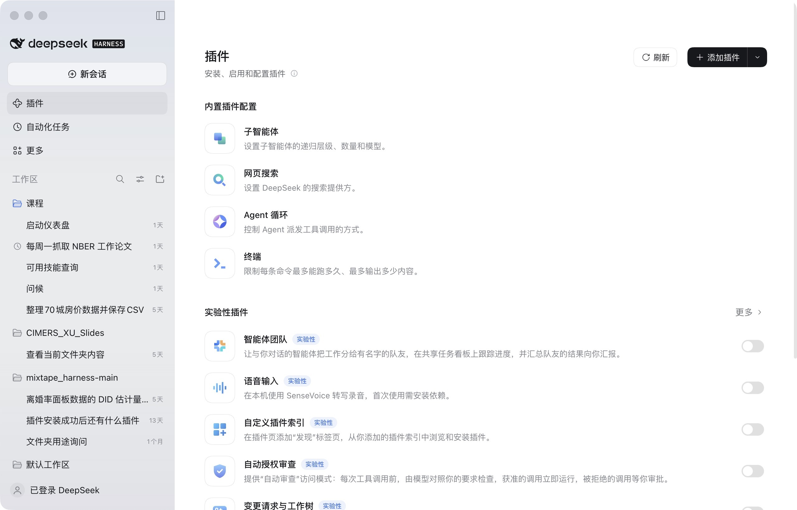

### 2. 填写安装地址

对话框接受 npm 包名、GitHub 仓库地址或本地目录路径。本插件在仓库的 `journalfinder/` 子目录里，所以地址要写明提交号和子目录：

```text
github:wenddymacro/dsh_skills_metrics#<提交号>&path:/journalfinder
```

把 `<提交号>` 换成要安装的那个版本的提交号。截图里用的是 `58ce7a8a0764aef9417c812ffcac9330cd20f7cf`，也就是合并 journalfinder 之后的 `main`。

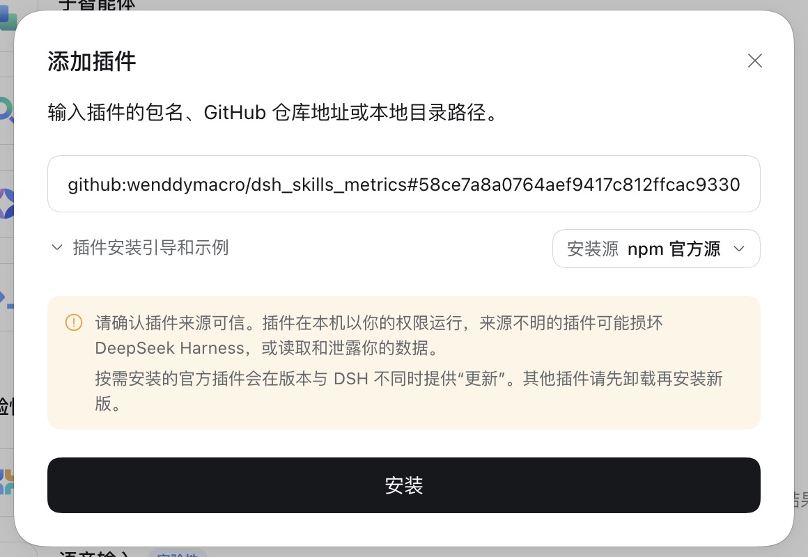

### 3. 点击「安装」，等待下载完成

插件里有约 19 MB 的期刊库，下载需要一点时间。

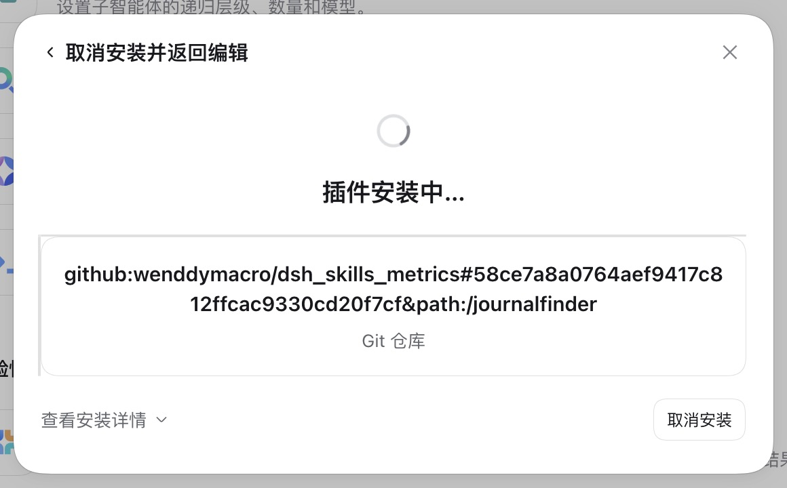

### 4. 点击「立即启用」

对话框显示「已安装」和版本号 `0.1.0` 后，点击「立即启用」。

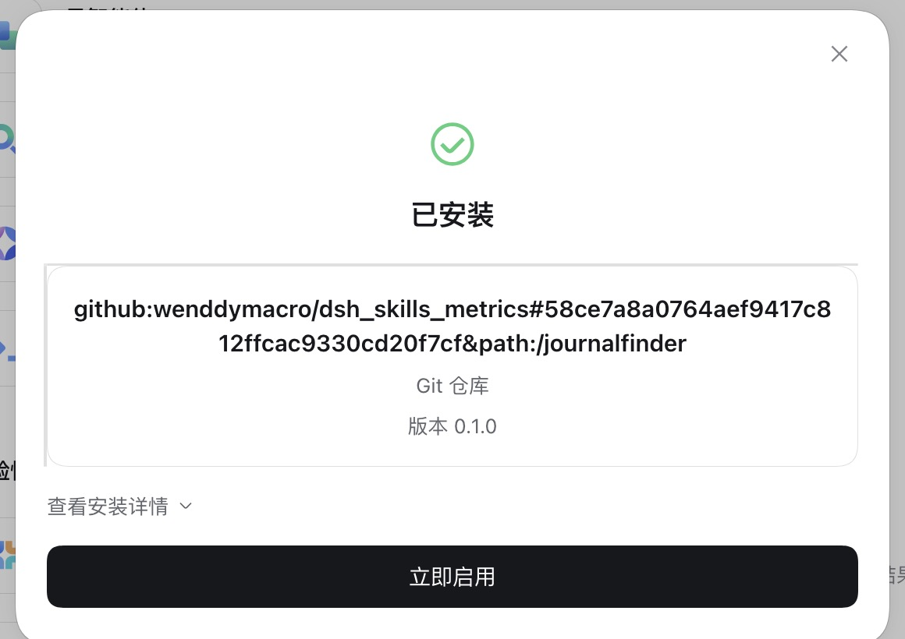

回到插件页面，「已安装插件」里会出现「期刊推荐」，右边的开关是打开的。英文界面里它叫「Journal Finder」。

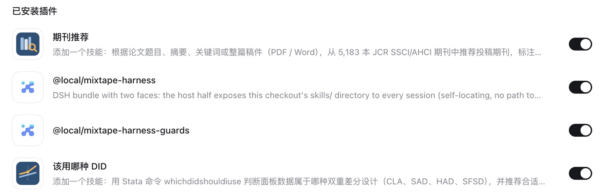

点击「期刊推荐」进入详情页，可以看到版本号、包名 `@dsh-skills-metrics/journalfinder` 和功能说明。卸载按钮也在这一页。

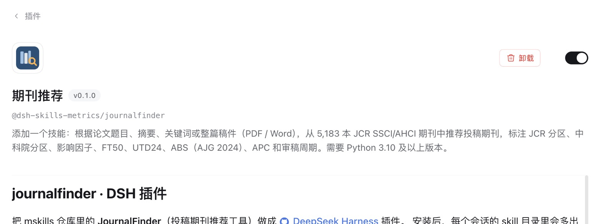

> 如果你以前用本地目录装过这个插件，后来又改从 GitHub 安装，请先退出并重新打开 DeepSeek Harness。不重启的话，正在运行的进程还会用旧版本的代码。

## 二、提问

### 5. 新建会话并提问

把稿件放进工作区。截图里是「默认工作区」，对应的本机目录是 `~/Documents/deepseek-harness/default-workspace/`。然后点击「新建会话」，确认输入框上方选中了这个工作区，再用自然语言提出要求：

```text
工作区里的 sample_paper.txt 是我的论文，帮我推荐投稿期刊。求档次，主题要贴合，只要 Q1–Q2。请用中文回答。
```


除了给稿件文件，也可以直接给题目和摘要，或者只描述研究主题：

```text
帮我找期刊。标题：Minimum Wages and Youth Employment: Evidence from Chinese Counties。
摘要：……（粘贴摘要）。偏好：主题贴合优先，兼顾档次；APC 不超过 3000 美元。
```

```text
我的论文研究最低工资对青年就业的影响，用了 DID，数据来自中国，投哪里合适？
```

也可以在输入框里输入 `/find-journal`，直接调用这个 skill。如果提问时没说偏好，agent 会先问一次你更看重哪些方面，比如主题贴合、求档次、求快、预算有限、国人友好或容量稳。

### 6. agent 加载 skill 并查询期刊库

发送后，agent 先加载 `find-journal` 技能并读取稿件，再运行插件自带的 Python 脚本查询期刊库：

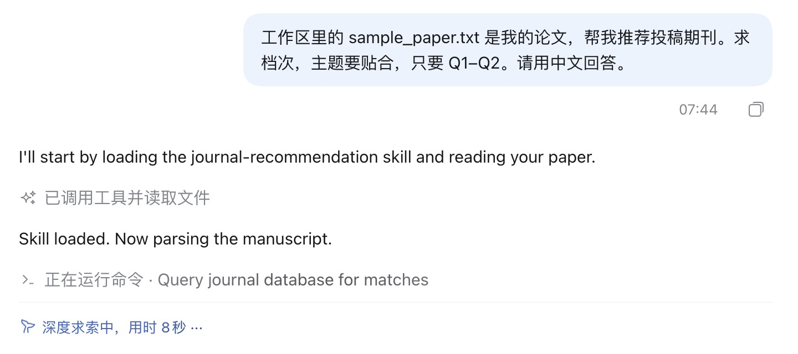

回答完成后，点击回答上方的「已完成，用时 … 秒」，再展开「执行了命令」，可以看到每一步：解析稿件（Parse the manuscript metadata）、查询期刊库（Query journal database for matches）、汇总结果，再用补充关键词检查有没有遗漏的期刊。截图里这次一共用了 58 秒。

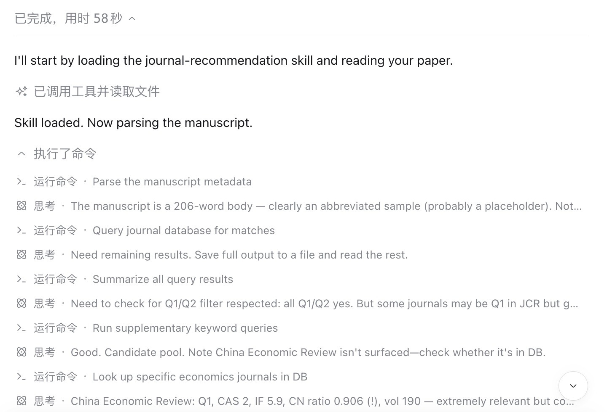

切换到「轨迹」标签页，可以看到每次工具调用的参数和返回值：`skill` 加载 `find-journal`，`read` 读取 `sample_paper.txt`，然后通过 `bash` 用 `python3` 运行插件的脚本。

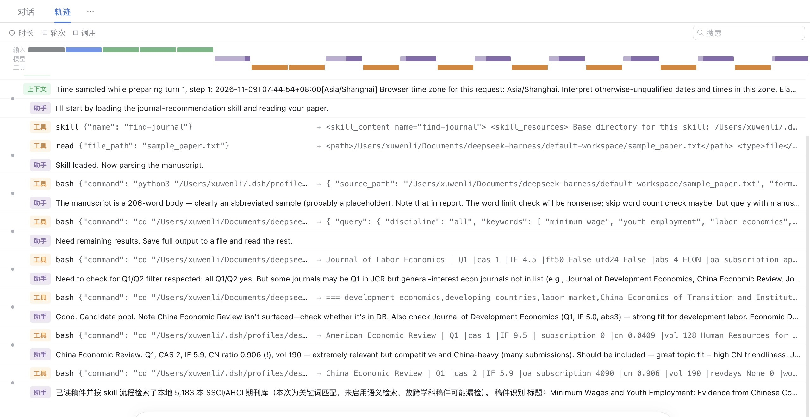

## 三、读懂结果

### 7. 稿件识别

回答开头说明检索范围，即本地的 5,183 本 SSCI/AHCI 期刊，并注明「本次为关键词匹配，未启用语义检索」。插件不带语义索引，所以这是**预期结果**，不是故障。

接下来是 agent 从稿件里识别出的标题、方法、数据和文章类型：

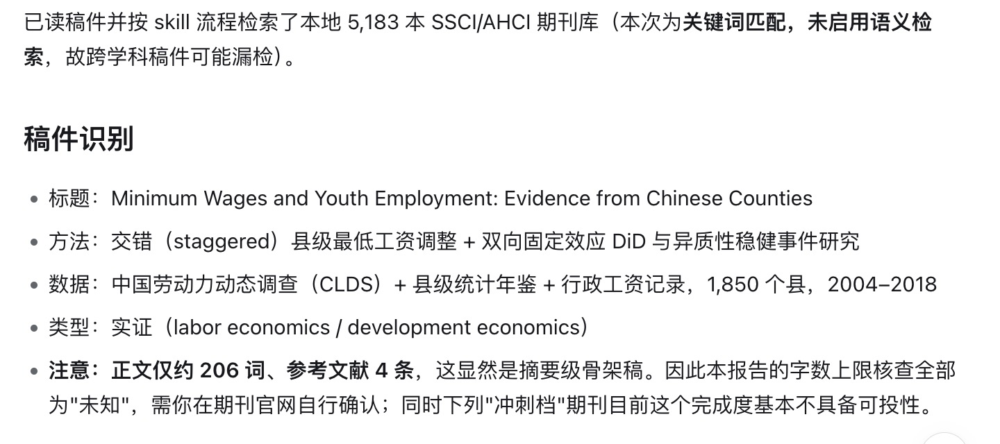

示例稿件的正文只有约 206 词，agent 发现后提醒这是骨架稿，因此字数限制核查全部是「未知」。用真实稿件时，正文会有几千词，agent 会拿它和期刊的字数上限比较。

### 8. 推荐期刊表

表格列出 5–8 本候选期刊，标注 JCR 分区、中科院分区、影响因子、ABS 星级、OA 方式与 APC，以及国人发文占比。本例按「主题贴合 + 求档次」排序，而且全部是 Q1–Q2：

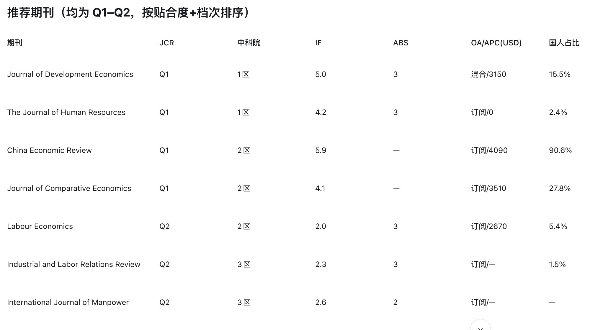

- **主题贴合是门槛**：表里的期刊都先达到主题贴合度的下限，再按你的偏好排序。
- **「—」表示库里没有这项数据**，不代表期刊没有这项内容。审稿周期、国人占比和字数限制的数据覆盖率都不高。
- **FT50、UTD24 和 ABS**：如果候选期刊都不在 FT50 或 UTD24 名单上（商科以外很常见），表格会省略这两列。ABS 为「—」表示期刊不在 AJG 2024 里，不代表档次低。

### 9. 补充备选与前三本分析

表格下面会列出补充备选，并说明缺失值的含义。接着逐本分析排名前三的期刊：为什么贴合、有什么风险、属于冲刺、稳妥还是保底。

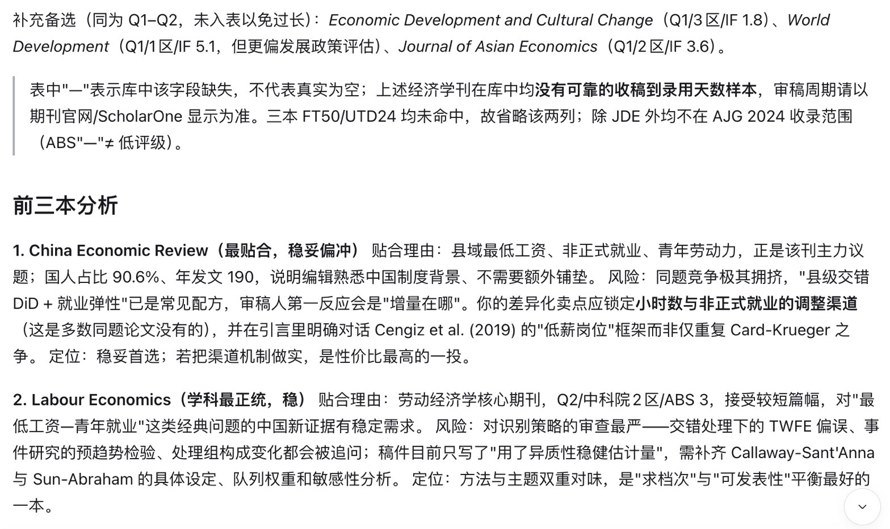

### 10. 提醒与下一步

最后，agent 会指出稿件本身影响投稿的问题。本例指出了两点：稿件完成度太低，以及数据的时间跨度需要自查。它还会问你要不要换一种偏好重新排序，比如「求快」或「预算有限」。

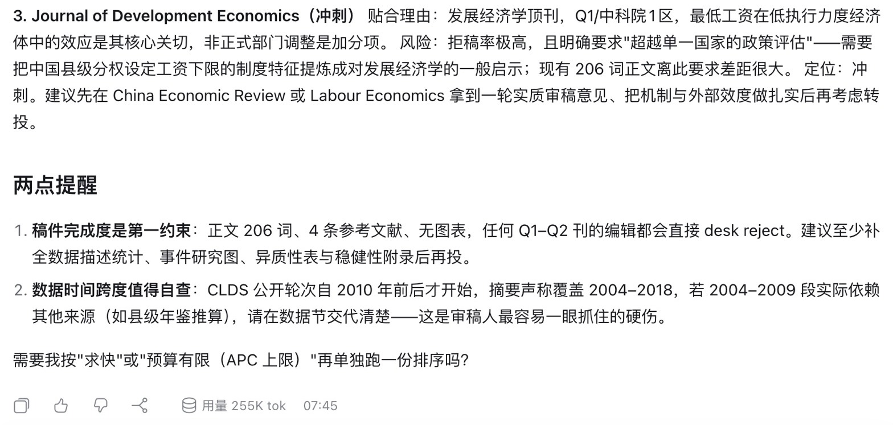

> 这个插件只**推荐投稿候选**，不预测能否录用，也不替你改稿。

## 商科名单筛选

提问时说出名单或星级要求，agent 会加上对应的硬筛选条件：

| 说法 | 对应的筛选 |
|---|---|
| 只看 FT50 | `--ft50-only` |
| 只看 UTD24 | `--utd24-only` |
| ABS 3 星以上 | `--min-abs 3` |
| ABS 4* | `--min-abs 4*` |

名单里有少数期刊不在 SSCI/AHCI 库中，例如 *Production and Operations Management* 和 *INFORMS Journal on Computing*，这些期刊推荐不到。

## 卸载

在插件详情页点击「卸载」，然后确认（见第 4 步的详情页截图）。

## 常见问题

| 现象 | 原因与处理 |
|---|---|
| `python3: command not found` | 安装 Python 3.10 或更新版本；在 Windows 上，agent 会改用 `python` |
| PDF 稿件报 `No module named 'pypdf'` | 运行 `python3 -m pip install pypdf`，或者改用 `.docx` |
| 提示 PDF 没有文本层 | 扫描版 PDF 无法解析。改用有文本层的 PDF 或 `.docx`，或者直接粘贴题目和摘要 |
| 旧版 `.doc` 无法解析 | 另存为 `.docx` |
| 回答里说「本次为关键词匹配」 | 这是正常现象，插件不带语义索引。跨学科论文提问时，多给几个各领域的关键词 |
| 推荐的期刊和主题不太相关 | 补充或改写关键词，突出研究问题和领域，不要只写国家和方法；也可以放宽分区、APC 等筛选条件 |
| 想要的期刊没出现 | 期刊库只收 JCR SSCI/AHCI 期刊和环境健康交叉期刊，纯理工期刊和临床医学期刊不在库内 |
| 回答用的是英文 | 提问时加上「请用中文回答」 |
| 重装插件后还是旧版本的行为 | 退出并重新打开 DeepSeek Harness |
