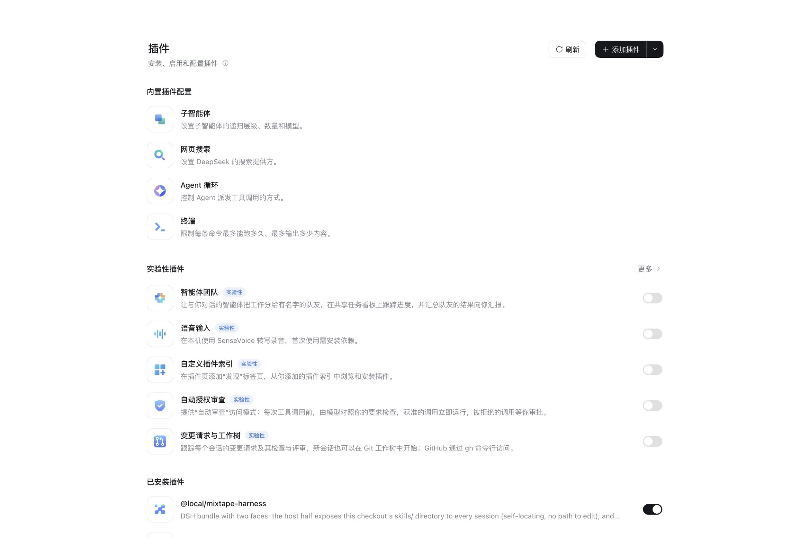
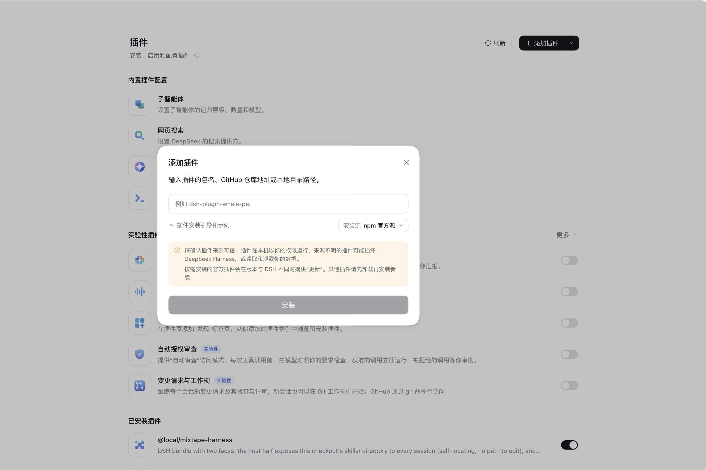
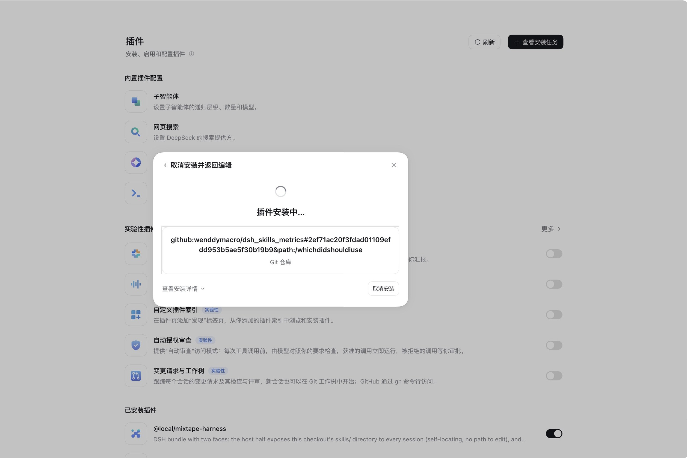
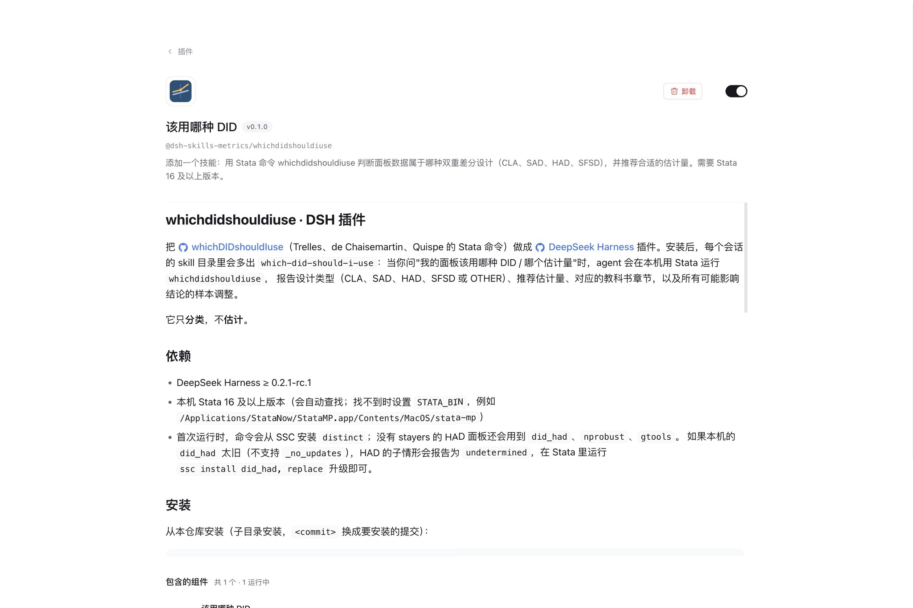
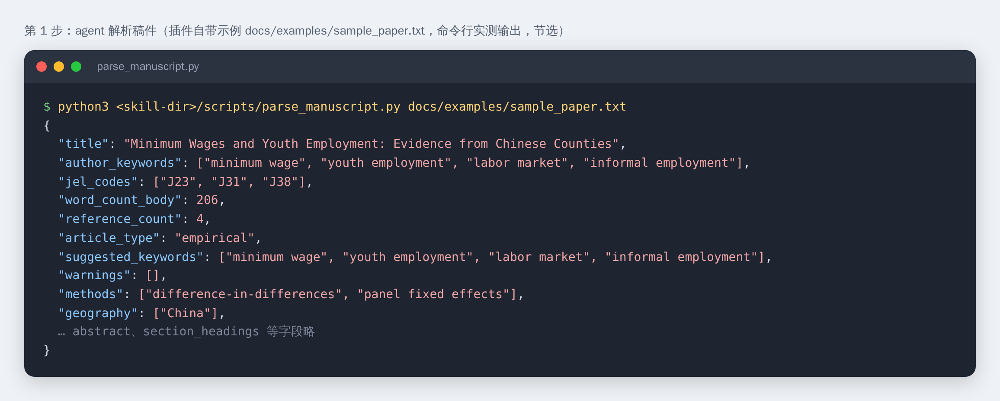
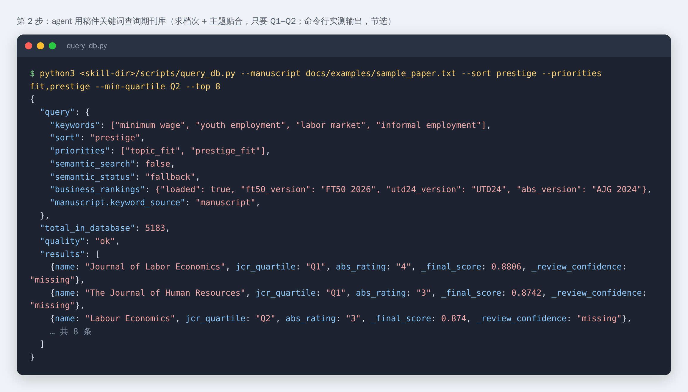
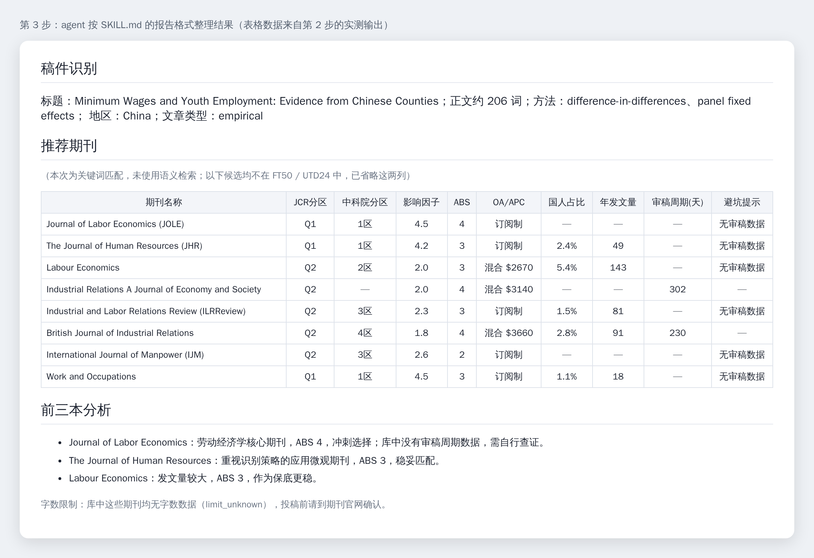
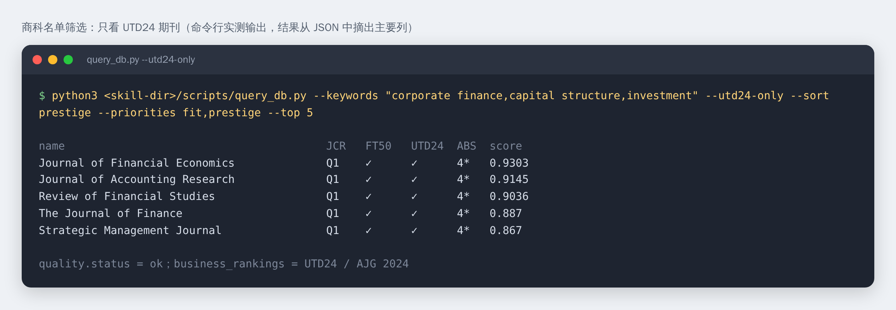
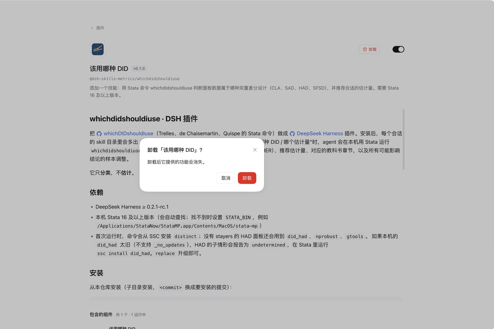

# 使用指南：在 DeepSeek Harness 里找投稿期刊

本指南演示从安装插件到拿到期刊推荐的完整过程。示例稿件是插件自带的
[`docs/examples/sample_paper.txt`](examples/sample_paper.txt)（一篇用 DID 研究中国最低工资与青年就业的虚构论文），
可以照着做一遍，检查环境是否就绪。

关于截图：

- **安装部分**的截图是 DeepSeek Harness 桌面版的真实界面，借用自
  [whichdidshouldiuse 的使用指南](../../whichdidshouldiuse/docs/GUIDE.md)。安装流程完全相同，只是图中的插件名和地址是那个插件的，
  照做时换成本插件的地址即可。
- **提问和结果部分**的图片是插件脚本的命令行实测输出（Linux，Python 3.13），也就是 agent 在后台实际运行的命令和拿到的数据。
  第 3 步的报告按 SKILL.md 规定的格式排版，表格数据来自同一次查询；DeepSeek Harness 里 agent 的措辞会有所不同。

## 准备

- DeepSeek Harness 0.2.1-rc.1 或更新版本，已登录。
- 本机已安装 Python 3.10 或更新版本。终端里运行 `python3 --version`（Windows 上是 `python --version`）检查。
- 只有解析 PDF 稿件时才需要额外安装 `pypdf`：

  ```bash
  python3 -m pip install pypdf
  ```

  `.docx`、`.txt` 稿件和直接粘贴题目摘要都不需要。
- 不需要联网：期刊库随插件一起安装。

## 一、安装插件

### 1. 打开「插件」页面，点击「添加插件」



### 2. 在弹出的对话框里填写安装地址

对话框接受 npm 包名、GitHub 仓库地址或本地目录路径。



本插件位于仓库的 `journalfinder/` 子目录，所以地址里要写上提交号和子目录：

```text
github:wenddymacro/dsh_skills_metrics#<提交号>&path:/journalfinder
```

`<提交号>` 换成你要安装的版本对应的提交（在 GitHub 仓库的提交历史里复制完整的 40 位哈希）。

### 3. 点击「安装」，等待下载完成

插件包含约 19 MB 的期刊库，下载比 whichdidshouldiuse 稍慢。



### 4. 安装完成后点击「立即启用」


启用后，插件详情页的开关处于打开状态，「包含的组件」显示「1 运行中」。回到插件列表，「已安装插件」里能看到「期刊推荐」
（英文界面显示为「Journal Finder」）。



> 如果你曾经用本地目录安装过这个插件，又改成从 GitHub 安装，请先退出并重新打开 DeepSeek Harness。不重启的话，正在运行的进程会继续使用旧版本的代码。

## 二、提问

新建会话，用自然语言描述论文并提出要求。三种输入方式都可以：

**给稿件文件**（把文件放进当前工作区，或写绝对路径）：

```text
工作区里的 sample_paper.txt 是我的论文，帮我推荐投稿期刊。求档次，只要 Q1–Q2。请用中文回答。
```

**给题目和摘要**：

```text
帮我找期刊。标题：Minimum Wages and Youth Employment: Evidence from Chinese Counties。
摘要：……（粘贴摘要）。偏好：主题贴合优先，兼顾档次；APC 不超过 3000 美元。
```

**只描述主题**：

```text
我的论文研究最低工资对青年就业的影响，用了 DID，数据来自中国，投哪里合适？
```

也可以在输入框里输入 `/find-journal`，直接调用这个 skill。

如果没有说明偏好，agent 会先问一次：

> 你更看重哪些方面？可多选：主题贴合、求档次、求快、预算有限、国人友好、容量稳；也可以说"均衡推荐"。
> 有没有硬性要求，比如只要 FT50 / UTD24、ABS 3 星以上、APC 上限、只要 OA、只要 Q1–Q2？

## 三、agent 做了什么

展开回答上方的「已完成，用时 … 秒」或切换到「轨迹」标签页，可以看到 agent 先**加载技能 `find-journal`**，再通过 `bash`
依次运行下面两个脚本。

### 第 1 步：解析稿件

给了稿件文件时，agent 先运行 `parse_manuscript.py`，拿到标题、关键词、JEL、正文字数、研究方法、地区和文章类型。
方法和地区只作为背景，不会当作期刊 scope 关键词。



> 示例稿件很短，所以正文只有 206 词。真实稿件会得到几千词，用来和期刊的字数上限比较。

### 第 2 步：查询期刊库

agent 把偏好换成参数（这里「求档次 + 主题贴合，只要 Q1–Q2」对应
`--sort prestige --priorities fit,prestige --min-quartile Q2`），并用 `--manuscript` 传入稿件，以便检查字数限制。



几个值得看的字段：

| 字段 | 含义 |
|---|---|
| `semantic_status: "fallback"` | 插件只做关键词匹配，这是**预期结果**，不是故障 |
| `business_rankings` | FT50 / UTD24 / ABS 标注层已加载及其版本 |
| `quality: "ok"` | 有足够多主题贴合的期刊；若为 `limited_matches` / `no_good_match`，agent 会建议放宽条件，而不是用不相关的期刊凑数 |
| `_review_confidence: "missing"` | 库里没有这本期刊的审稿周期数据，审稿速度只能当弱信号 |

## 四、读懂结果

### 第 3 步：推荐报告

回答依次给出稿件识别结果、推荐期刊表和前三本的分析：



- **主题贴合是门槛**：表里的期刊都先过了主题贴合度下限，再按偏好排序。
- **缺失值写 `—`**：审稿周期、国人占比、字数限制的覆盖率都不高，`—` 表示库里没有数据，不代表没有限制。
- **FT50 / UTD24 / ABS**：候选都不在任何名单上时（商科以外很常见），这几列会被省略；`ABS` 为空表示不在 AJG 2024 中，不代表档次低。
- **字数限制**：大多数期刊是 `limit_unknown`，投稿前请到期刊官网确认。
- **冲刺 / 稳妥 / 保底**：agent 通常挑 5–8 本，搭配 1–2 本冲刺、3–4 本稳妥、1–2 本保底。

> 这个插件只做**投稿候选推荐**，不预测录用，也不替你改稿。

### 商科名单筛选

提到 FT50、UTD24 或 ABS 星级时，agent 会加上对应的硬筛选，例如「只看 UTD24」对应 `--utd24-only`：



其他常用说法：「只要 FT50」→ `--ft50-only`，「ABS 3 星以上」→ `--min-abs 3`，「ABS 4*」→ `--min-abs 4*`。
名单中少数期刊（如 *Production and Operations Management*、*INFORMS Journal on Computing*）不在 SSCI/AHCI 库里，推荐不到。

## 卸载

在插件详情页点击「卸载」，然后确认：



## 常见问题

| 现象 | 原因与处理 |
|---|---|
| `python3: command not found` | 安装 Python 3.10+；Windows 上 agent 会改用 `python` |
| PDF 稿件报 `No module named 'pypdf'` | 运行 `python3 -m pip install pypdf`，或改用 `.docx` |
| 提示 PDF 没有文本层 | 扫描版 PDF 无法解析，改用文本 PDF、`.docx`，或直接粘贴题目和摘要 |
| 旧版 `.doc` 无法解析 | 另存为 `.docx` |
| 回答里说"本次为关键词匹配" | 正常：插件不带语义索引。跨学科论文在提问时多给几个各领域的关键词 |
| 推荐的期刊和主题不太相关 | 补充或改写关键词（突出研究问题和领域，不要只写国家、方法），或放宽 Q 分区、APC 等筛选条件 |
| 想要的期刊没出现 | 库只覆盖 JCR SSCI/AHCI（及环境健康交叉）期刊；纯理工、临床医学期刊不在库内 |
| 回答用的是英文 | 在提问时加上「请用中文回答」 |
| 重装插件后，行为仍是旧版本 | 退出并重新打开 DeepSeek Harness |
