# 使用指南：在 DeepSeek Harness 里做中国宏观计量研究

本指南用 DeepSeek Harness 桌面版演示 MaRCo 宏观计量研究助手的完整用法：从安装插件、提出研究问题、确认 VAR 设计，
到下载国家统计局数据、估计和读懂结果。示例问题是：

> 中国的货币政策冲击对工业生产和 CPI 有什么影响？用国家统计局的月度数据，帮我设计一个 VAR。

所有截图都来自 2026-11-16 在一台 macOS 机器上的真实操作，使用 DeepSeek Harness 桌面版、模型
DeepSeek-V4.1-Flash 和本机 Python 3.13。截图按 Retina 原始分辨率保存，点开可以看清细节。
agent 的回答每次会略有不同，截图只是一次运行的样子。

## 准备

- DeepSeek Harness 0.2.1-rc.1 或更新版本，已登录。
- 本机已安装 Python 3.10 或更新版本。在终端运行 `python3 --version` 检查；Windows 上运行 `python --version`。
- Python 包：
  - 只下载和清洗国家统计局数据：`numpy`、`pandas`、`PyYAML`；
  - 做估计和出报告：再加上 `scipy`、`statsmodels`、`plotly`，并且 `numpy<2`。

  不用提前装。第一次使用时 agent 会运行检查，缺什么就把安装命令给你看，你同意后它再安装。
- 网络：下载国家统计局数据要能访问 https://data.stats.gov.cn/ 。只做研究设计、不取数时不需要联网。

## 一、安装插件

### 1. 打开「插件」页面

点击左侧栏的「插件」，再点击右上角的「添加插件」。


### 2. 填写安装地址

对话框接受 npm 包名、GitHub 仓库地址或本地目录路径。本插件在仓库的 `marcobis/` 子目录里，所以地址要写明版本标签和子目录：

```text
github:wenddymacro/dsh_skills_metrics#marcobis-v0.2.0&path:/marcobis
```

`#` 后面是版本标签，上面是目前最新的版本 0.2.0；也可以填提交号。
截图是用更早的提交 `9b60749` 截的，安装过程完全一样。以后有新版本时，agent 会在对话里提醒你更新，见 [README 的「更新」](../README.md#更新)。

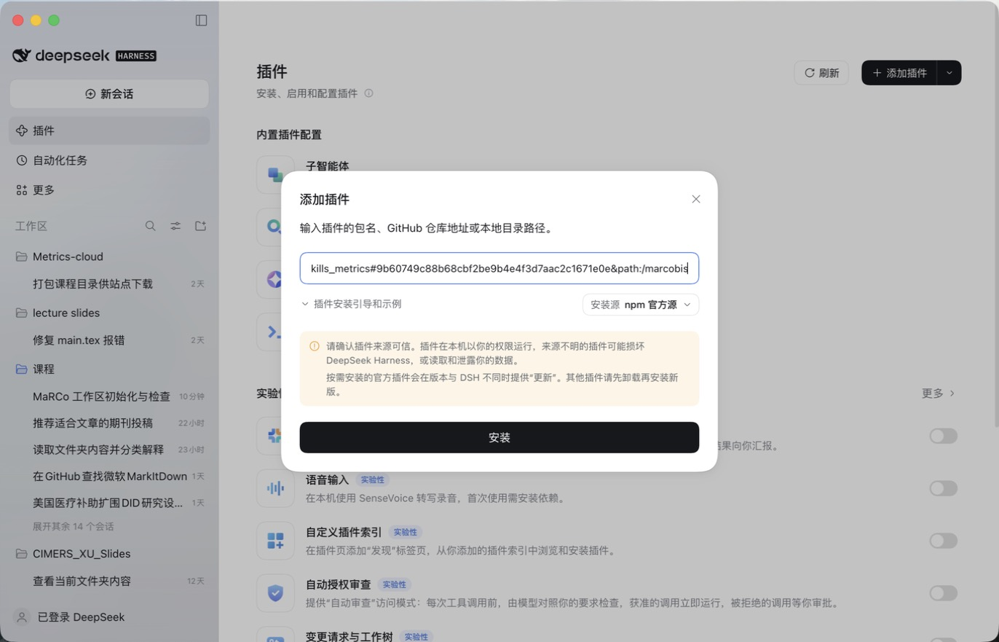

### 3. 点击「安装」，等待下载完成

插件带着完整的框架模板（估计代码、30 篇论文的复现、测试），下载需要半分钟左右。

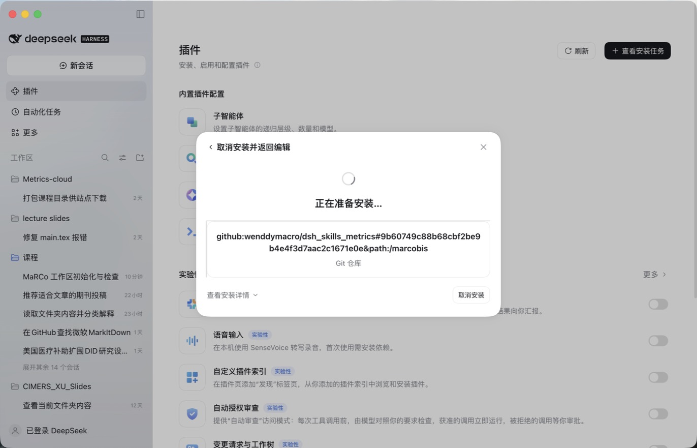

### 4. 点击「立即启用」

对话框显示「已安装」和版本号 `0.1.0` 后，点击「立即启用」。

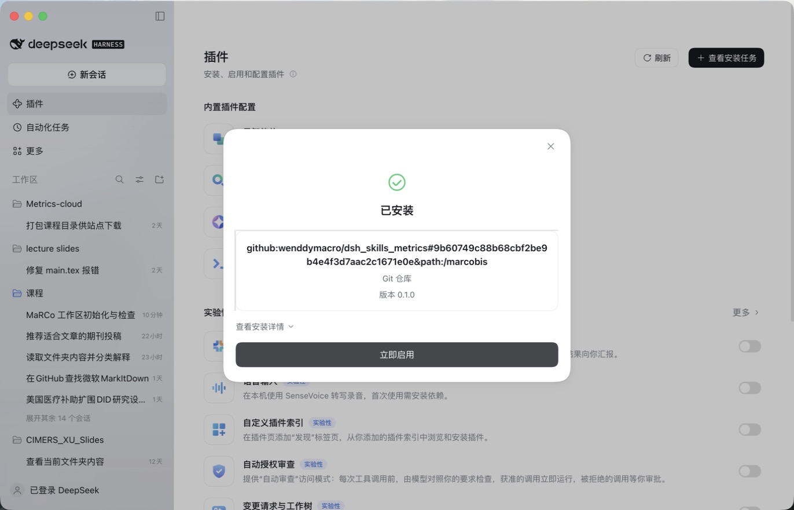

回到插件页面，「已安装插件」里会出现「MaRCo 宏观计量研究助手」，右边的开关是打开的。英文界面里它叫「MaRCo macroeconometric companion」。

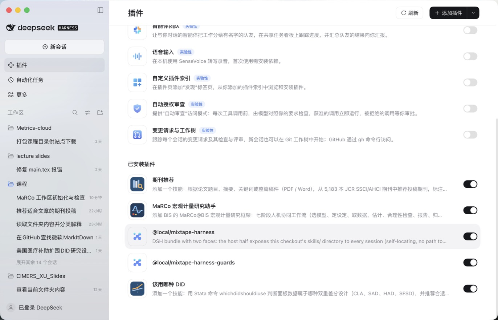

点击它进入详情页，可以看到版本号、包名 `@dsh-skills-metrics/marcobis` 和插件的 README。卸载按钮也在这一页。

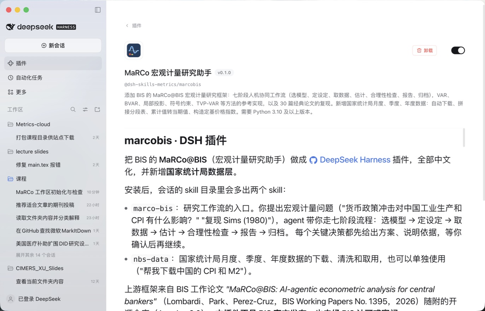

> 如果你以前用本地目录装过这个插件，后来又改从 GitHub 安装，请先退出并重新打开 DeepSeek Harness。不重启的话，正在运行的进程还会用旧版本的代码。

## 二、提问

### 5. 确认 skill 已加载

新建会话，在输入框里输入 `/marco`，列表里会出现 `marco-bis`；输入 `/nbs` 会出现 `nbs-data`。
插件只挂载这两个 skill。框架里的 12 个子 skill（主控、设定、诊断等）不出现在列表里，agent 会按需读取。

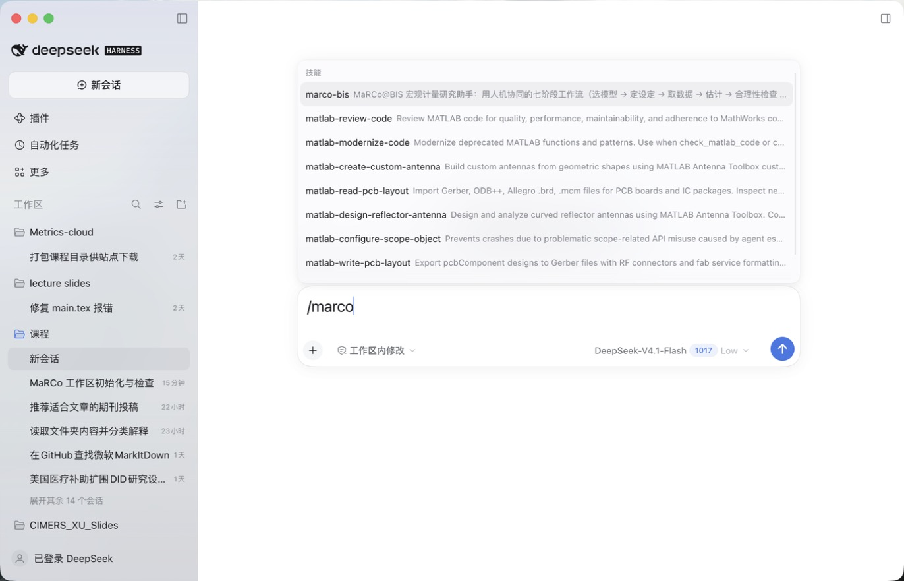

一般不需要手动调用，直接用自然语言提问，agent 会自己加载合适的 skill。

### 6. 提出研究问题

选好工作区，用自然语言提出问题：

```text
中国的货币政策冲击对工业生产和 CPI 有什么影响？用国家统计局的月度数据，帮我设计一个 VAR。工作区放在 /tmp/marco-guide。
```

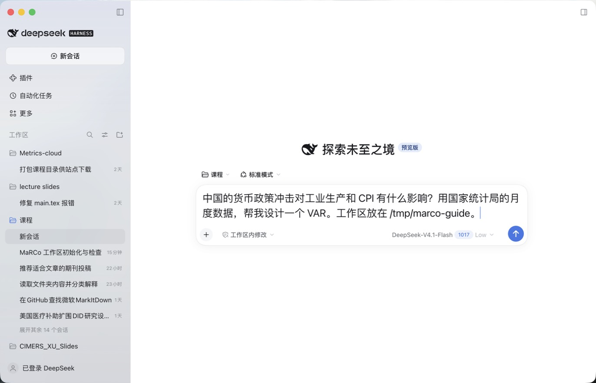

最后一句指定了 **MaRCo 工作区**的位置。这个工作区不是 DeepSeek Harness 左侧栏的「工作区」，而是框架代码、数据和分析结果存放的目录。不指定时，agent 会先征得你同意，再在 `~/marco-workspace` 创建。也可以设置环境变量 `MARCO_WORKSPACE`。插件升级不会覆盖工作区里你的文件。

其他问法示例：

```text
复现 Sims (1980) 的六变量 VAR。
```

```text
下载国家统计局的月度和季度宏观数据，告诉我 CPI 定基指数是怎么构造的。
```

```text
我有一篇论文的 PDF，帮我复现它的 BVAR。
```

前一个是**模式 A**（复现模型字典里已有的论文），最后一个是**模式 B**（新论文，先起草设定再复现），本例和第二个属于**模式 C**（从研究问题出发设计设定）或单独的数据任务。

### 7. agent 准备工作区并读取框架

发送后，agent 先加载 `marco-bis` 和 `nbs-data` 两个 skill，检查 Python 和工作区状态，然后在 `/tmp/marco-guide` 初始化工作区，读工作区里的 `CLAUDE.md` 和主控 skill。点击回答上方的「已完成，用时 … 」，再展开「执行了命令…」，可以看到每一步：


初始化后的工作区结构：

```text
/tmp/marco-guide/
├── CLAUDE.md, README.md, CONVENTIONS.md ...   # 操作说明与数学约定
├── skills/                                    # 12 个子 skill + 模型字典
├── scripts/lib/                               # 估计代码（VAR、BVAR、LP、符号约束……）
├── scripts/replications/                      # 30 篇经典论文的复现
├── scripts/applications/<研究 id>/            # 你的分析：DESIGN.md、脚本、outputs/
├── scripts/tools/nbs_update.py, nbs_tool.py   # 国家统计局数据工具
└── data/nbs_m/, nbs_q/, nbs_a/                # 国家统计局月度 / 季度 / 年度面板
```

## 三、确认设计

### 8. 回答 agent 的关键问题

MaRCo 的规则是：每个关键决策都**先给出具体方案和理由，等你确认**，不会默默替你决定。本例中 agent 发现了一个关键问题：
国家统计局不发布政策利率，所以要先决定用什么变量代表货币政策冲击。它给出三个方案并标出推荐项：


这一轮共有三个问题（政策工具、其余设定是否按推荐、确认后是否马上取数），用左下角的箭头翻页，选好后点「提交」。
也可以在「输入你的答案」里写自己的想法，比如「用 M2 同比，只用统计局数据」。截图这次三个问题都选了推荐项：
DR007 为基准、其余按推荐、先出设计暂不取数。

### 9. 读设计方案

agent 根据你的选择写出锁定的 v1 设定：变量、来源、在 VAR 中的角色和 Cholesky 排序的经济含义，以及样本、滞后阶数、虚拟变量和稳健性方案。
标为 `nbs_m` 的变量来自插件的国家统计局月度面板；DR007 不在统计局数据里，标为「外部（1 条）」。

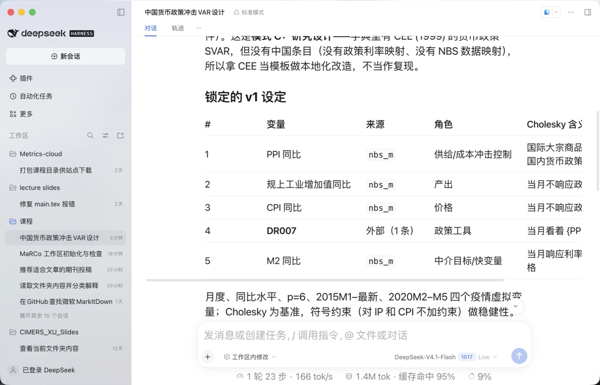

接下来是做出这些决定的理由。本例里有三条：政策工具为什么不能来自统计局，为什么用 PPI 代替 CEE (1999) 的商品价格指数，
以及为什么用同比而不是季调后的环比（统计局序列大多未经季节调整，还有春节效应）。

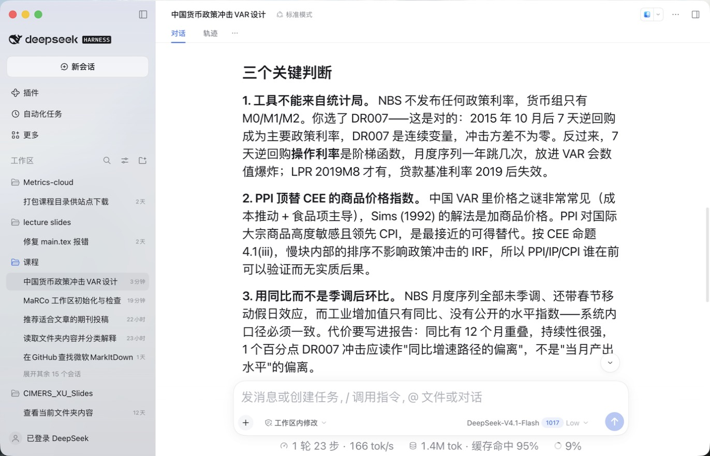

最后是**事先预判的异常**（价格之谜、流动性效应缺失、弱识别）和对应的补救顺序，以及进入下一阶段前还需要你做的事。
本例停在第 3 阶段（取数）之前，等你提供 DR007 的来源，并同意联网下载 `nbs_m` 面板：

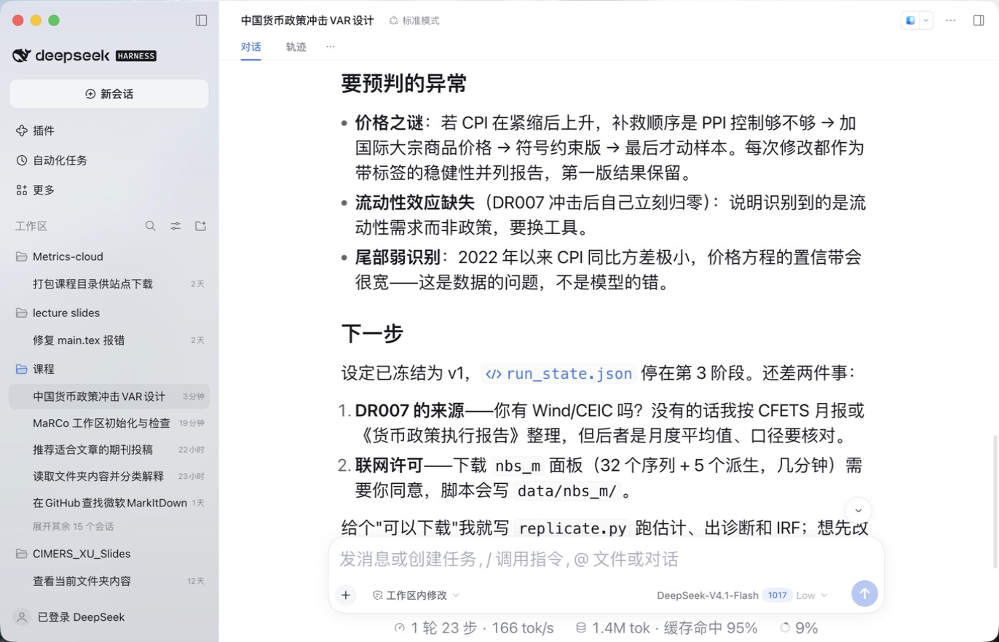

设计全文和决策记录保存在工作区里：

- `scripts/applications/china_mp_var/DESIGN.md`：设计文档，状态、方案比较、变量表、可行性测算；
- `scripts/applications/china_mp_var/outputs/research_log.md`：研究日志，逐阶段记录每个决策及其依据和你的确认；
- `scripts/applications/china_mp_var/outputs/run_state.json`：运行状态，下次会话可以从中断的阶段继续。

### 10. 后面的阶段

回复「可以下载」之后，agent 按七阶段流程继续：

| 阶段 | agent 做什么 | 你需要做什么 |
|---|---|---|
| 3 取数 | 运行 `nbs_update.py` 下载并清洗统计局数据；外部序列按约定的来源取得 | 同意联网；提供面板里没有的序列 |
| 4 估计 | 写 `replicate.py`，调用 `scripts/lib/` 估计 | — |
| 5 合理性检查 | 检查平稳性、残差，指出价格之谜、爆炸根等异常并提出补救 | 决定是否接受补救方案 |
| 6 报告 | 脉冲响应图、表格、HTML 报告 | 提修改意见 |
| 7 归档 | 更新研究日志，处置这次运行的代码和产出 | 选择处置方式 |

任何阶段都可以改之前的决策，agent 只重跑受影响的部分。下一节就是一个例子。

## 四、取数并估计

### 11. 改设定，只下载需要的序列

截图这次手头没有 DR007，于是改用第 8 步的方案 B：只用统计局数据，以 M2 同比作为政策变量。同时要求只下载模型用到的 4 个序列，
不下载整个月度面板：

```text
DR007 我暂时没有，先做纯统计局的 M2 版本（方案 B）：PPI 同比、工业增加值同比、CPI 同比、M2 同比四个变量，M2 放最后，样本 2010 年起。可以联网，但只下载这 4 个序列：nbs_update.py --panel nbs_m --only ppi_yoy,ip_yoy,cpi_yoy,m2_yoy --start 2010-01。下载完直接估计，出诊断和脉冲响应图。
```


`--only` 只下载列出的序列，`--start` 只取 2010 年以后的数据，请求很少，可以降低触发网站防火墙的风险。

### 12. 下载

展开执行步骤里的 `Download 4 NBS monthly series`，可以看到下载输出：4 个序列都是 ✓，CPI、PPI 到 2026-10，工业增加值和 M2
到 2026-09。整个下载用了 89 秒。依赖这些序列的 `cpi_inflation`、`ppi_inflation`（把「上年同月=100」换算成百分比）也一起算好了。

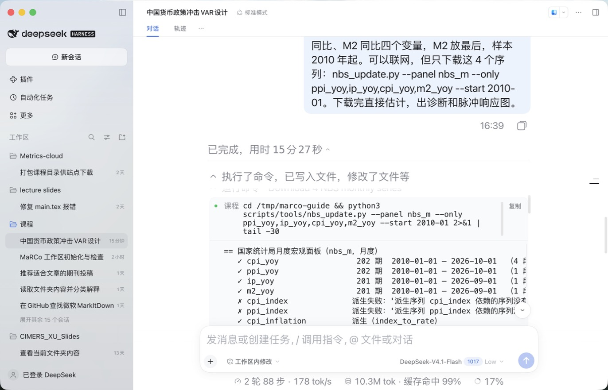

> 截图里的 `cpi_index`、`ppi_index` 两行 ✗ 是旧版本的误报：这两个定基指数还需要环比序列，而环比不在 `--only` 列表里。
> 现在的版本会显示「跳过（缺少输入 …）」，不算失败。

### 13. 估计、检查和归档

agent 写好 `replicate.py` 并运行，然后自己做合理性检查。本例中它发现 6 阶滞后时残差有自相关，于是比较了 6、12、13 阶，最后取 12 阶，
并把三种结果都保留下来。整个过程约 15 分钟。

结果出来后，agent 先按第 7 阶段的要求问这次运行怎么处置：保存为应用、仅归档、继续迭代还是丢弃。另一个问题是要不要安装 `plotly`
来生成交互式报告（截图的 Python 环境里没有装）。截图这次选了「保存为应用」和「不用装」。


### 14. 读结果

回答先给出脉冲响应表：一个标准差的 M2 扩张冲击（约 0.49 个百分点）在第 6、12、24 个月对各变量的影响和峰值：

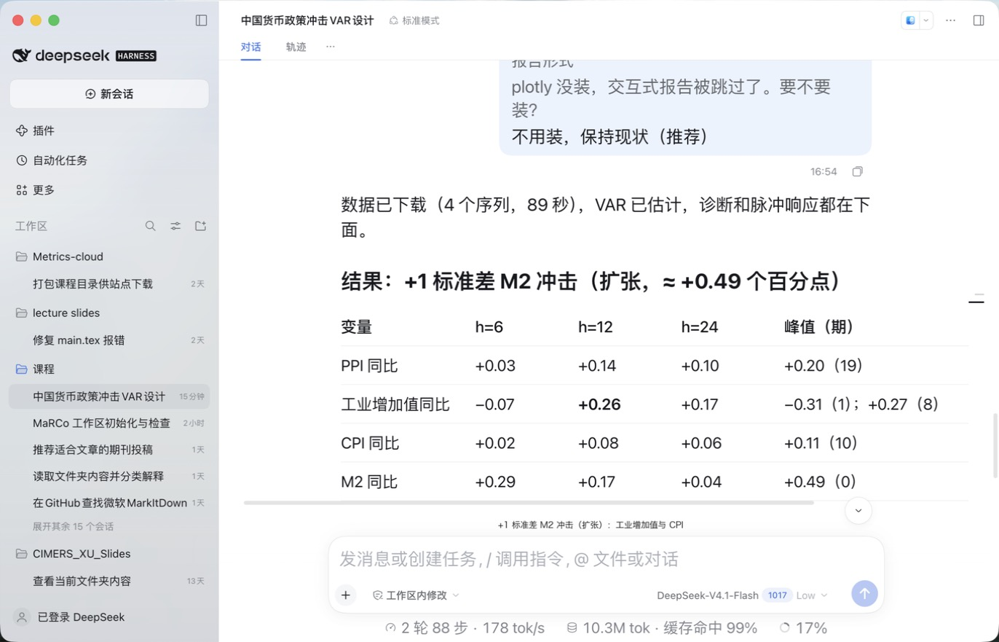

接着是工业增加值和 CPI 的脉冲响应图，深浅两层阴影是 agent 给出的两档置信带：

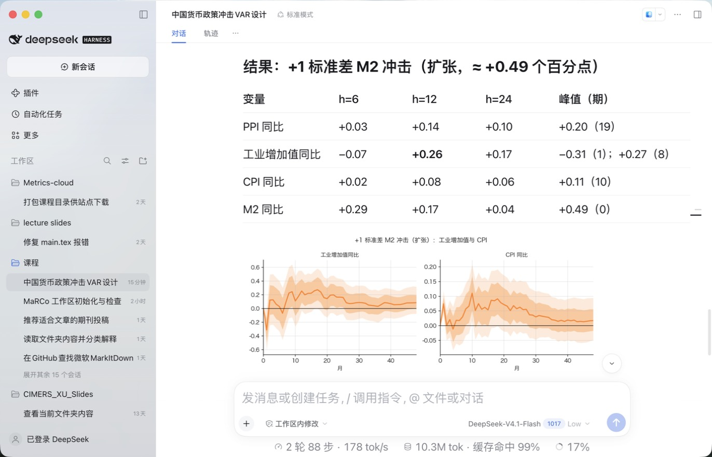

然后是结论：M2 冲击对工业生产有正向效应，第 12 个月约 +0.26 个百分点，而且显著；对 CPI 方向为正，但置信区间包含 0；对 PPI
没有结论；没有出现价格之谜。

更重要的是 agent 主动指出的三个问题：短期形状对滞后阶数敏感；最大特征根 0.97，接近单位根，响应 48 个月后仍未归零；
M2 不是干净的政策工具，识别出的更接近「货币总量冲击」。

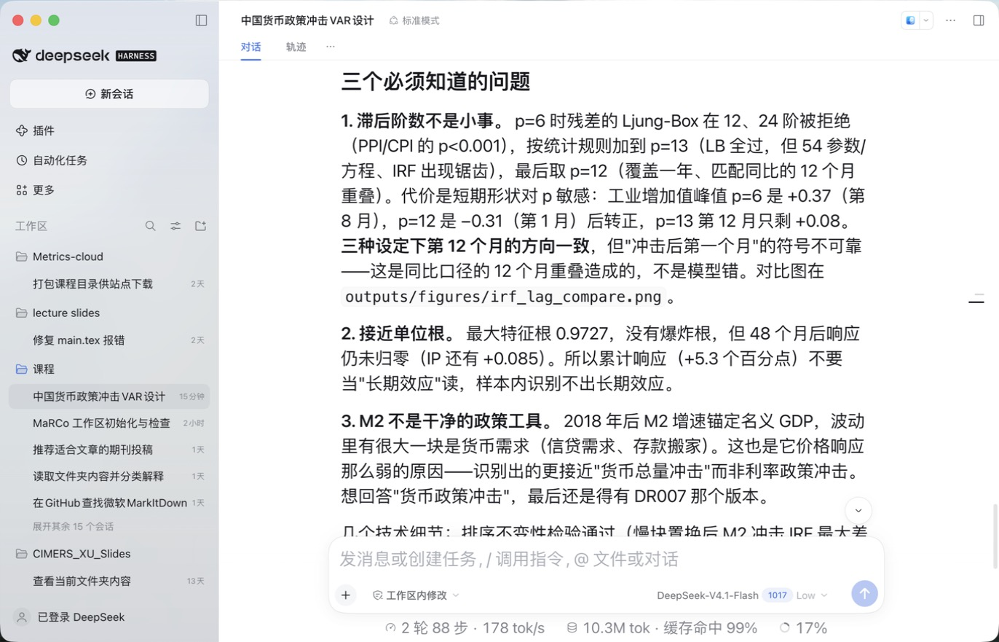

最后列出产出文件，并建议下一步：补上 DR007，跑价格型版本，再做符号约束稳健性检验。


产出都在工作区的 `scripts/applications/china_mp_var/` 下：

| 文件 | 内容 |
|---|---|
| `replicate.py`、`config.yaml` | 估计脚本和设定，可以重跑 |
| `outputs/report.html` | 完整报告：设定、解读、图、稳健性、诊断。没有 `plotly` 时，图以 PNG 形式内嵌 |
| `outputs/figures/*.png` | 脉冲响应图、滞后阶数对比图 |
| `outputs/key_responses.csv`、`results_summary.json`、`numerical_results.json` | 数值结果 |
| `outputs/research_log.md` | 七阶段研究日志 |
| `README.md` | 「保存为应用」时写的说明：问题、做法、主要发现、注意事项 |

> 这只是演示用的一次运行，结论依赖于设定，不代表对中国货币政策效果的研究结论。

## 五、单独使用国家统计局数据

不做完整研究、只要数据时，直接说「帮我下载国家统计局的月度数据」即可，agent 会使用 `nbs-data` skill。
也可以在工作区根目录自己运行：

```bash
python3 scripts/tools/nbs_update.py --panel nbs_q          # 季度面板（nbs_m 月度、nbs_a 年度、all 全部）
python3 scripts/tools/nbs_tool.py browse 月度 "金融"        # 浏览目录
python3 scripts/tools/nbs_tool.py indicators 月度 "金融/货币供应量"
```

下载后每个面板目录里有：

| 文件 | 内容 |
|---|---|
| `dataset.csv` | 清洗后的数据：分段表已拼接，累计值已换算成当月 / 当季值，价格已链接成定基指数（2020=100） |
| `raw.csv` | 平台原始值，便于核对 |
| `series_info.csv` | 每列的中文名、单位、清洗步骤、起止日期、样本内缺失期数、建议变换 |
| `transform_codes.csv` | FRED-MD 格式的变换编码 |
| `metadata.yaml` | 下载日期（vintage）、分段重叠期冲突、定基指数核对误差 |

在分析脚本里读取：

```python
import lib   # 脚本放在 scripts/applications/<id>/ 下，先把 scripts/ 加进 sys.path，写法见各复现的 replicate.py
df = lib.load_dataset(source="nbs_m", series=["cpi_index", "ip_yoy", "m2"], start="2010-01", dropna=False)
```

注意两点：

- **网站防火墙。**国家统计局网站请求过密时会对本机 IP 返回人机验证页，持续几个小时。客户端每秒最多一个请求，遇到验证页立即停止、不重试。
  请一次只运行一个下载进程；被限制时，等几个小时再下载。
- **季节性。**除 PMI 和季度 GDP 环比外，序列都未经季节调整。用水平量建模前要先处理季节性，agent 会在设定阶段提醒。

## 卸载

在插件详情页点击「卸载」，确认对话框里再点「卸载」。


卸载只删除插件本身。MaRCo 工作区（本例的 `/tmp/marco-guide`，默认的 `~/marco-workspace`）里的代码、数据和分析结果都会保留，不需要时请手动删除。
