# 使用指南：在 DeepSeek Harness 里求解 SFC 模型

本指南用 DeepSeek Harness 桌面版演示整个流程：安装插件，然后在同一个会话里做两个实验。

- 模型 SIM：政府支出从 20 提高到 25。
- 模型 PC：利率从 2.5% 提到 3.5%。

两个模型都来自 Godley & Lavoie《Monetary Economics》，插件自带它们的示例文件。照着做一遍，就能确认环境是否就绪。

所有截图都在同一台 macOS 机器上实际操作得到，使用 DeepSeek Harness 0.2.1-rc.4、Python 3.13 和模型 DeepSeek-V4.1-Flash。

## 准备

- DeepSeek Harness 0.2.1-rc.1 或更新版本，并已登录。
- 本机已安装 Python 3.10 或更新版本。在终端运行 `python3 --version` 检查。
- 还需要 `numpy`、`pandas`、`sympy`、`scipy`、`matplotlib`、`tqdm`、`tabulate` 这几个包。缺少的不用提前装，第一次使用时 agent 会检查（见第 6 步）。想自己先装好，可以运行：

  ```bash
  python3 -m pip install numpy pandas sympy scipy matplotlib tqdm tabulate
  ```

- SFCmodeler 本身随插件一起安装，**不要**运行 `pip install SFCmodeler`。

## 一、安装插件

### 1. 打开「插件」页面

点击左侧栏的「插件」，再点击右上角的「添加插件」。


### 2. 填写安装地址

本插件位于仓库的 `sfcmodeler/` 子目录，所以地址里要写明提交号和子目录：

```text
github:wenddymacro/dsh_skills_metrics#0cbf46af1cc23b5183816a81273942f50e05a543&path:/sfcmodeler
```

截图里用的是 `0cbf46a`，也就是本指南写作时的 `main`。要装别的版本，把 `#` 后面换成对应的提交号即可。


### 3. 点击「安装」

插件不打包任何 npm 依赖，几十秒内就能装完。

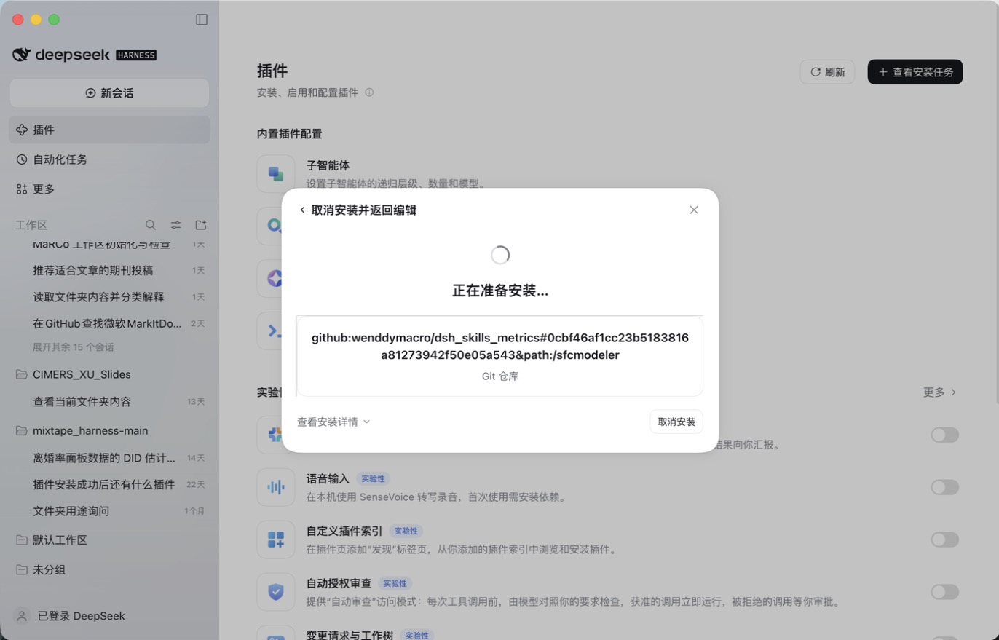

### 4. 点击「立即启用」

对话框显示「已安装」和版本号 `0.1.0` 后，点击「立即启用」。

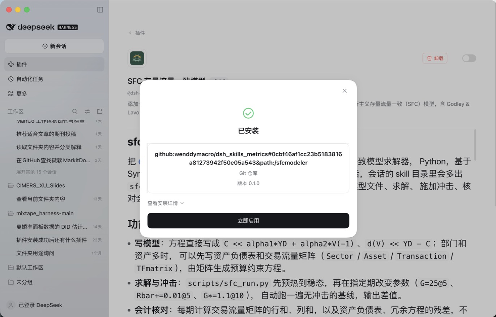

回到插件页面，「已安装插件」里会出现「SFC 存量流量一致模型」，右边的开关已经打开。英文界面里它叫「SFC stock-flow consistent models」。


点击它进入详情页，可以看到版本号、包名 `@dsh-skills-metrics/sfcmodeler` 和插件的 README。卸载按钮也在这一页。

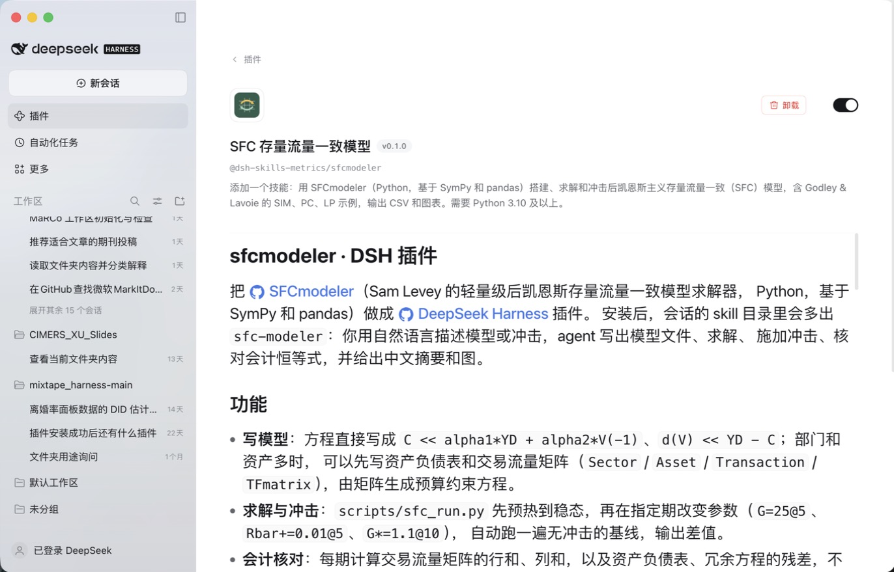

> 如果以前装过另一个来源或版本的这个插件，先卸载，再按上面的步骤安装。装好后退出并重新打开 DeepSeek Harness，否则正在运行的进程还会使用旧代码。

## 二、第一个实验：模型 SIM 的财政扩张

### 5. 新建会话并提问

点击「新会话」，确认输入框上方选中了要用的工作区。截图里选的是「默认工作区」，对应本机目录 `~/Documents/deepseek-harness/default-workspace/`。agent 写的模型文件和输出都会放在这个工作区里。

然后用自然语言提问：

```text
用 Godley-Lavoie 的模型 SIM，把政府支出从 20 提高到 25，画出 GDP 和家庭现金的动态路径。
```


也可以在输入框里输入 `/sfc-modeler`，直接调用这个 skill。

### 6. agent 检查环境、写模型、求解

发送后，界面先显示「正在分析请求」，然后依次显示当前在运行的命令。


回答完成后，点击回答上方的「已完成，用时 … 」，再展开「执行了命令，已读取图片，已调用工具等」，就能看到每一步。这次的顺序是：

1. 加载 `sfc-modeler` 技能。
2. 运行 `sfc_doctor.py` 检查 Python 环境。
3. 读取插件自带的 `examples/sim.py`。
4. 发现缺少 `sympy`，把它装进工作区。
5. 写出模型文件 `sim_G25_model.py`。
6. 用 `--describe` 检查方程。
7. 预热到稳态，在第 5 期施加冲击，与基线比较，最后画图。

全程用了 3 分 55 秒。


> **关于依赖安装**：这次运行中，`sympy` 被装进了工作区内的 `./pylibs` 目录，系统 Python 没有被改动，所以 agent 没有先征求同意。如果你希望每次安装前都先确认，可以在提问时说明「装依赖前先问我」，或者按「准备」一节提前装好。

### 7. 读结果

回答开头说明实验设计：先在 Gd = 20 时预热到稳态，然后在模型的第 78 期（模型年份 2078）把政府支出提高到 25，再与不施加冲击的基线比较。下面是 agent 画的图：

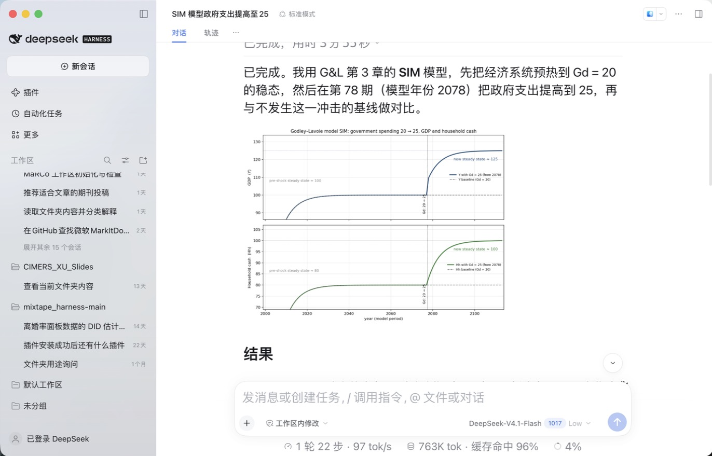

原图保存在工作区的 `sfc_output/sim_G25_model/` 里。下面就是这张图：上半部分是 GDP，下半部分是家庭现金；实线是施加冲击后的路径，虚线是基线，竖虚线标出冲击发生的那一期。

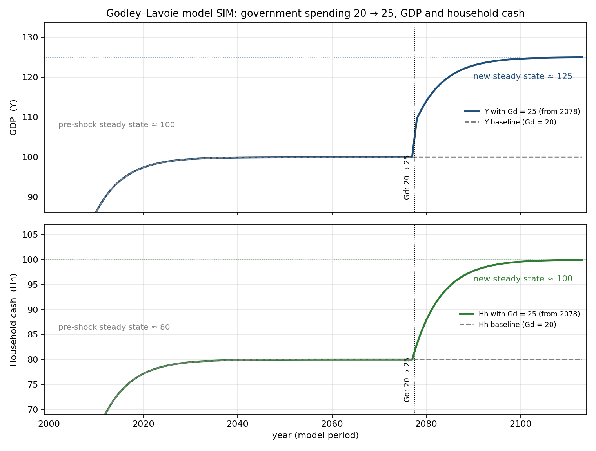

接着是结果表和动态特征：

- GDP 在冲击当期从 100 跳到 109.6，新稳态是 125。
- 家庭现金从 80 逐步升到 100。
- 两个稳态都和解析解 `Y* = G/θ`、`Hh* = G(1−θ)/θ` 一致。
- 冲击当期 GDP 增加 9.6，即 `5 / (1 − α₁(1−θ))`；当期家庭现金增加 3.1。这两个数都可以手算核对。

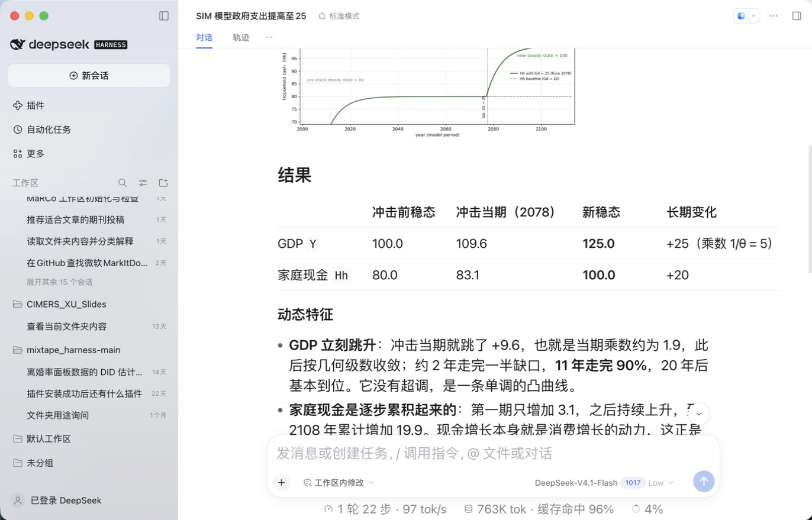

然后是经济逻辑：政府用新发行的货币支付新增支出，家庭的现金财富随之增加，消费跟着上升，收入和税收也一起增加，直到新增税收正好抵消新增支出为止，所以长期乘数是 1/θ = 5。接着是**会计核对**：家庭预算、生产、政府预算和货币市场 `Hs = Hh` 这四个恒等式的残差都在 1e−13 量级，全部通过。

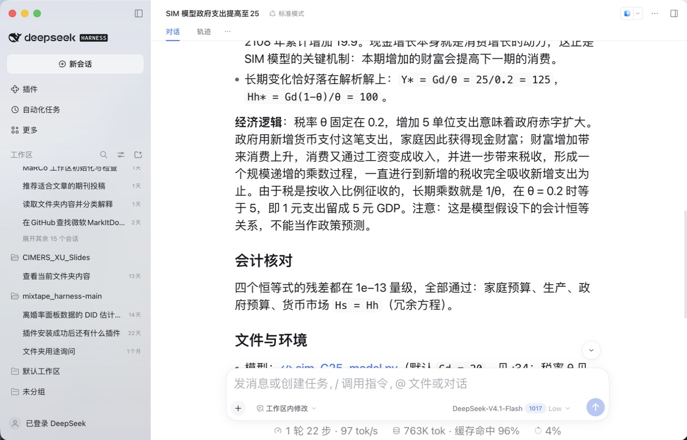

最后列出生成的文件，以及在终端复现这次计算的命令。


| 文件 | 内容 |
|---|---|
| `sim_G25_model.py` | 模型文件：方程、参数和会计核对 |
| `sfc_output/sim_G25_model/results.csv` | 施加冲击后每一期的取值 |
| `sfc_output/sim_G25_model/baseline.csv` | 不施加冲击的基线 |
| `sfc_output/sim_G25_model/diff.csv` | 冲击路径减去基线 |
| `sfc_output/sim_G25_model/checks.csv` | 每一期各恒等式的残差 |
| `sfc_output/sim_G25_model/summary.md` | 中文摘要：稳态、冲击前后取值、核对结论 |
| `sfc_output/sim_G25_model/plot_*.png` | 单变量图 |

以后想改参数，直接修改 `sim_G25_model.py`，再让 agent 重跑即可。

### 8. 看轨迹

切换到「轨迹」标签页，可以看到每次工具调用的参数和返回值。例如，`bash` 运行 `sfc_run.py --describe` 后返回「模型结构 方程 11 个，内生变量 11 个……」，求解后返回「预热：求解 73 期，已到达稳态」。


## 三、第二个实验：模型 PC 的加息

### 9. 在同一个会话里追问

```text
再做一个：在模型 PC 里把利率从 2.5% 提到 3.5%，对产出和家庭财富有什么影响？为什么利率上升反而提高了产出？
```

这次用了 1 分 29 秒，因为环境已经准备好了。agent 先在 R = 2.5% 时预热到稳态，再在第 84 期把政策利率 `Rbar` 提到 0.035。图分三部分：产出、家庭财富，以及国债、现金和产出相对基线的偏离。

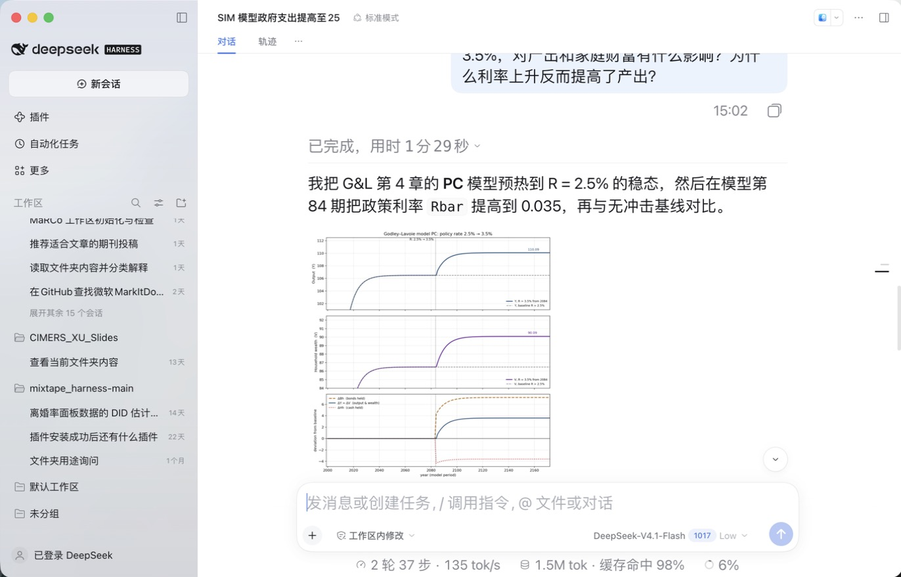

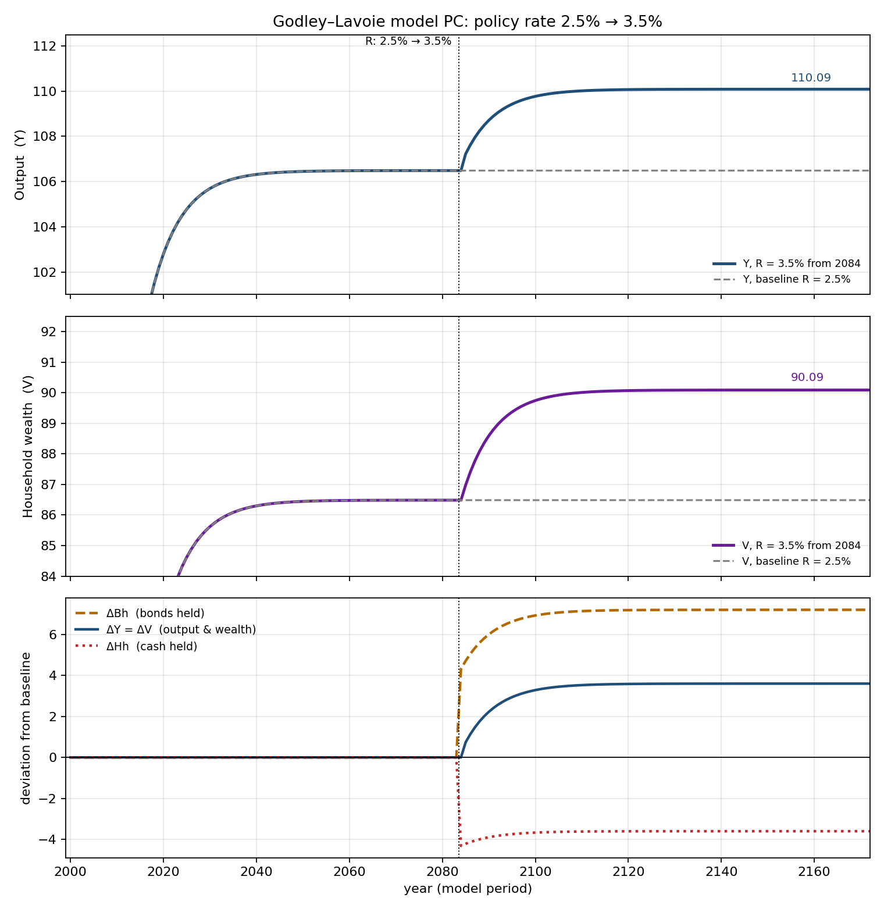

### 10. 结果与解释

基线稳态 Y = 106.49，和书中一致。加息后，产出和家庭财富都增加 3.6。家庭持有的国债增加 7.2，现金减少 3.6。

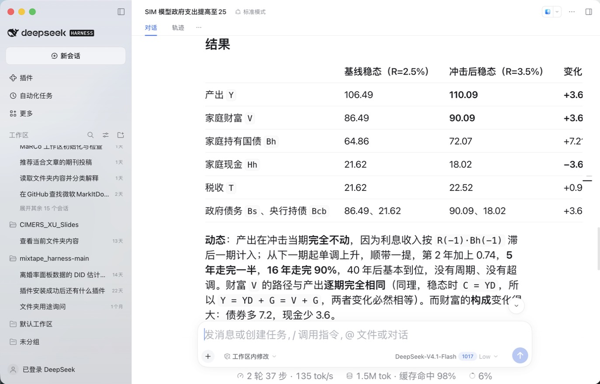

关于「为什么利率上升反而提高了产出」，agent 的解释是：在 PC 模型里没有投资，也没有银行贷款，利率对私人部门来说不是成本，而是政府付给家庭的利息收入。产出沿三个渠道上升：

1. **利息转移**：加息后家庭的利息收入增加 0.90。
2. **乘数**：长期乘数是 `(1−θ)/θ = 4`，所以产出增加 `4 × 0.90 = 3.60`，与模拟结果完全一致。
3. **财富效应**：收入增加使财富增加，财富又推高下一期的消费。


接着它解释了家庭现金为什么反而减少：国债更有吸引力，家庭把一部分现金换成了国债。最后它特别说明了这个结论的适用范围：「加息使产出上升」只在这种只有政府债务和家庭部门的模型里成立，在有投资的模型里不能照搬。

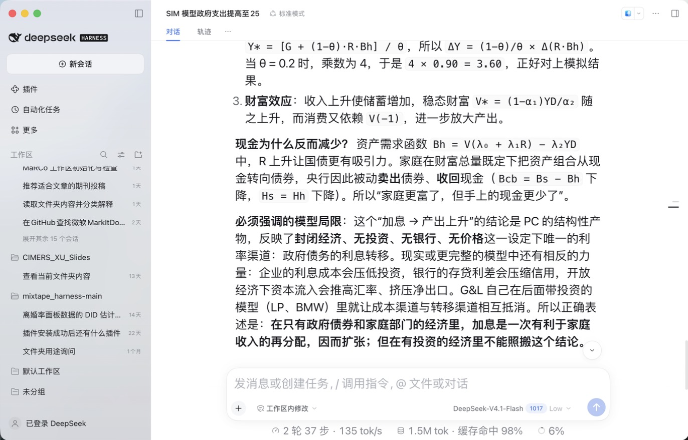

## 继续使用

其他可以直接问的问题：

```text
在模型 LP 里让长期债券价格从 20 降到 15，家庭财富和政府赤字怎么变？
```

```text
帮我写一个三部门（家庭、企业、政府）的 SFC 模型，企业向家庭借款投资，先给我看交易流量矩阵。
```

```text
把刚才 SIM 的税率改成 0.25，再做一次同样的冲击，和税率 0.2 的结果比较。
```

用矩阵写法时，agent 会先写资产负债表和交易流量矩阵，再由矩阵生成预算约束方程；回答里会逐行、逐列列出核对结果。

## 常见问题

- **回答里有「不通过」**：说明某个会计恒等式的残差不为 0，通常是方程漏写了一项，或者初始存量之间不一致。让 agent「检查哪条恒等式不通过并修正模型」即可。
- **提示「没有到达稳态」**：说明预热期数不够，或者模型本身不收敛。可以让 agent 增加预热期数，或者先不加冲击，单独看基线是否收敛。
- **图里的中文显示成方框**：插件生成的图默认用英文标签，避免缺字体的问题。需要中文标签时，先确认本机装有中文字体，再让 agent 改图。
- **在终端里直接运行**：命令写法见插件的 [README](../README.md#使用)。

## 卸载

在插件详情页点击「卸载」并确认。工作区里生成的模型文件、`sfc_output/` 和 `pylibs/` 不会被删除，不再需要时手动删除。
