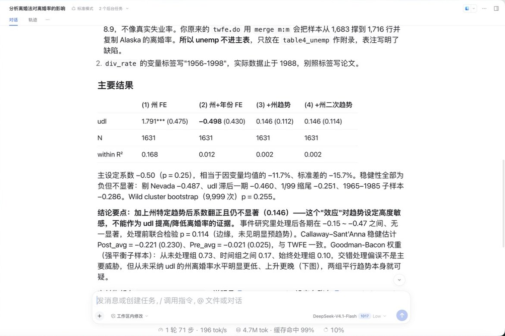

# statadataanalysis · DSH 插件

把一个 Stata 端到端实证分析的 skill 做成 [DeepSeek Harness](https://github.com/deepseek-ai/deepseek-harness) 插件。安装后，每个会话的 skill 目录里会多出
`stata-data-analysis`：当你给出一个 `.dta` / `.csv` / `.xlsx` 并要求"分析这个数据"、"跑个回归"、"出描述统计和回归表"时，agent 会先用 Stata 实际读数据、给出 Pre-Flight 报告，再写编号 do-file 放在 `analysis_<topic>/`，批处理运行并逐条检查 log，最后在 `analysis_<topic>/out/` 输出可发表的表和图。

工作流分五个阶段：

1. **Pre-Flight 报告**：`describe`、`codebook`、`misstable` 读出变量、观测数、面板结构、缺失和唯一键，先确认再写代码
2. **Setup 与加载**：固定的 do-file 开头（`version`、种子、日志）、外部命令检查、`isid` / `assert` 断言
3. **探索性分析**：描述统计、面板结构、缺失模式、分布与趋势图、处理前均衡性；DID 数据额外看处理时点
4. **主回归**：`reghdfe` / `regress` / `logit` / `ivreghdfe`，写明聚类层级的理由，逐步加设定，报告效应大小；每个设定都追加到 `quality_reports/spec-ledger.md` 设定台账
5. **输出与自查**：`esttab` 同时导出 `.tex`（booktabs）和 `.rtf`，图同时导出 `.pdf` 和 `.png`；读 log 查错误码、共线、singleton、不收敛和样本量变化

按识别策略（TWFE/DID、IV、RDD、Logit/Probit、少聚类）补齐对应的必做检查，例如交错 DID 的 Goodman-Bacon 分解与稳健估计量、IV 的第一阶段 F。

**图文使用指南：[docs/GUIDE.md](docs/GUIDE.md)**（从安装到读懂结果，附 DeepSeek Harness 桌面版实测截图）



## 依赖

- DeepSeek Harness ≥ 0.2.1-rc.1
- 本机 Stata 16 及以上版本（会自动查找；找不到时设置 `STATA_BIN`，例如
  `/Applications/StataNow/StataMP.app/Contents/MacOS/stata-mp`）
- 回归和出表用到的 SSC 包（`reghdfe`、`ftools`、`estout`、`coefplot` 等）缺失时，agent 会先告诉你再 `ssc install`

## 安装

**桌面版**：打开「插件 → 添加插件」，填入下面的地址，点击「安装」，再点击「立即启用」。`<commit>` 换成要安装的提交号。

```text
github:wenddymacro/dsh_skills_metrics#<commit>&path:/statadataanalysis
```

**命令行**（CLI 管理的 profile）：

```bash
dsh plugin --profile <profile> add "github:wenddymacro/dsh_skills_metrics#<commit>&path:/statadataanalysis"
```

从本地 checkout 安装（便于开发）：

```bash
dsh plugin --profile <profile> add "link:/abs/path/to/dsh_skills_metrics/statadataanalysis"
```

如果把已安装的插件换成另一个来源或版本，需要重启 DeepSeek Harness，新代码才会生效。

## 使用

直接用自然语言提问即可，例如：

> 当前目录下的 divorce_panel.dta 是州-年面板，用 TWFE 估计单方离婚法（udl）对离婚率（div_rate）的影响，按州聚类，出描述统计和回归表。

> 看看 data/wages.csv，做个完整的实证：工资对教育的回归，逐步加控制变量。

也可以输入 `/stata-data-analysis` 显式调用这个 skill。结果不对或复现不了时，配合同仓库的 [`statadiagnose`](../statadiagnose/) 插件排查。

## 结构

```
statadataanalysis/
├── package.json            # dsh.bundle 声明，不打包任何依赖
├── cordis.patch.yml        # 挂载本包的插件
├── index.js                # 用 dsh 自带的 skill-filesystem provider 挂载 skills/
├── locale/{en,zh}.json     # 插件管理器中显示的标题与描述
├── icon.svg
├── LICENSE, NOTICE
├── skills/stata-data-analysis/
│   ├── SKILL.md            # agent 的工作流程
│   ├── scripts/run_stata.sh  # 找到本机 Stata，批处理运行 do-file，报告错误码、警告和 log 末尾
│   └── UPSTREAM-LICENSE.txt  # 上游 MIT 许可原文
└── test.mjs                # node --test test.mjs
```

`run_stata.sh` 的用法：

```bash
bash skills/stata-data-analysis/scripts/run_stata.sh [--tail N] path/to/file.do [ARG ...]
```

在当前目录（项目根目录）以批处理模式运行，批处理 log `<file>.log` 放在 do-file 旁边，打印 log 路径、第一个 `r(###)` 错误码及其前文、
共线 / singleton / 不收敛 / 奇异方差矩阵 / 完全预测等警告，以及 log 末尾 N 行（默认 40）。有错误时退出码为 1。
`--which-stata` 显示将使用的 Stata，`--version` 显示 Stata 版本。

## 测试

```bash
node --test test.mjs
```

单元测试检查 manifest、patch、locale、SKILL frontmatter、`apply()` 的挂载方式和 `run_stata.sh` 的参数校验；本机有 Stata 时，
集成测试会检查运行成功、报错定位（`r(111)`）、共线警告和版本查询。

## 许可与致谢

MIT 许可。`skills/stata-data-analysis/SKILL.md` 改编自 Pedro H. C. Sant'Anna 的
[claude-code-my-workflow](https://github.com/pedrohcgs/claude-code-my-workflow) 中的 `/data-analysis`（提交 `fe70774`，MIT 许可），
改为 Stata 工作流并适配 DeepSeek Harness：去掉本机硬编码路径，改用自带的 `run_stata.sh` 运行 Stata。详见 [NOTICE](NOTICE)。
