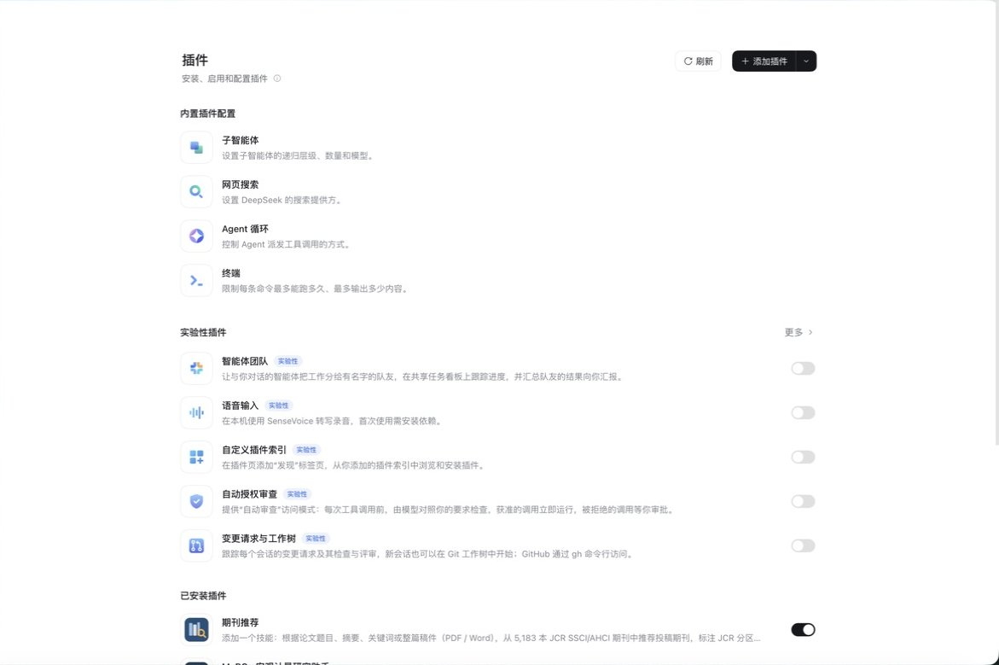
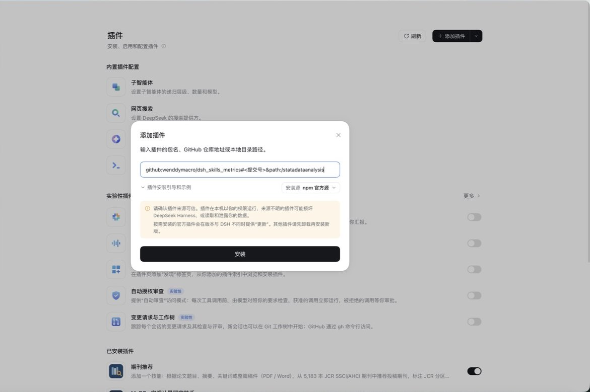
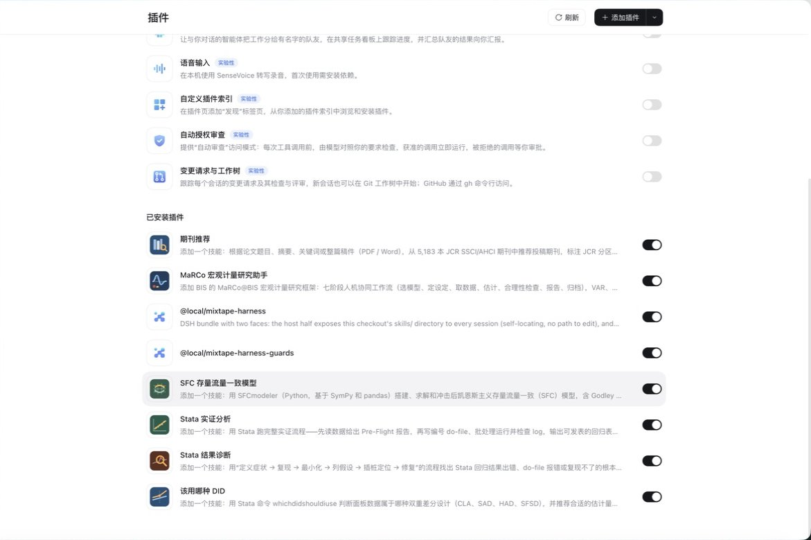
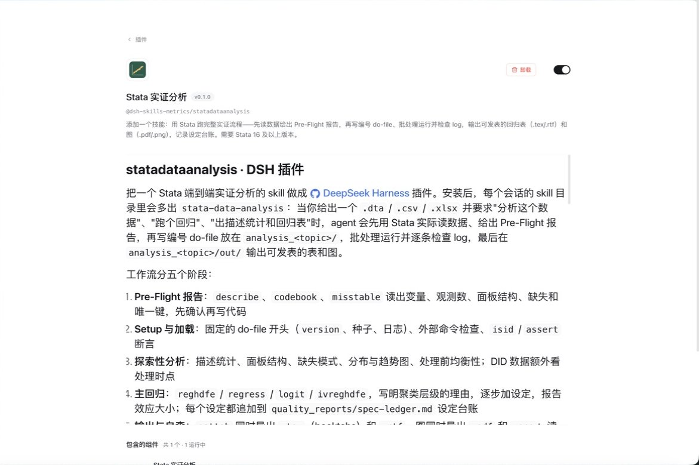
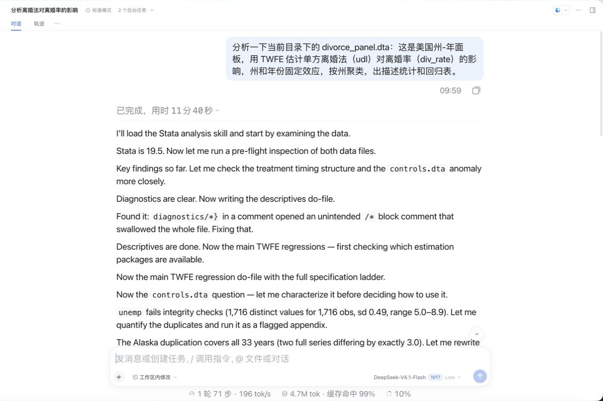
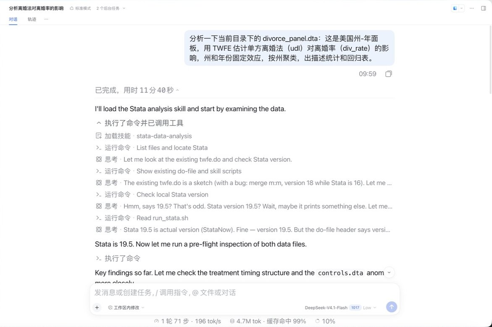
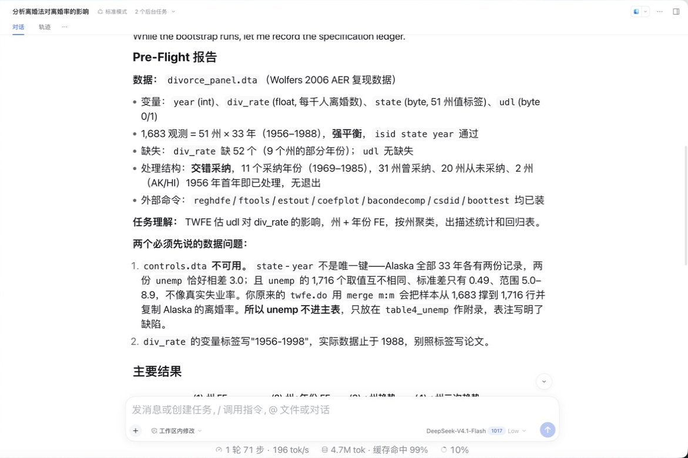
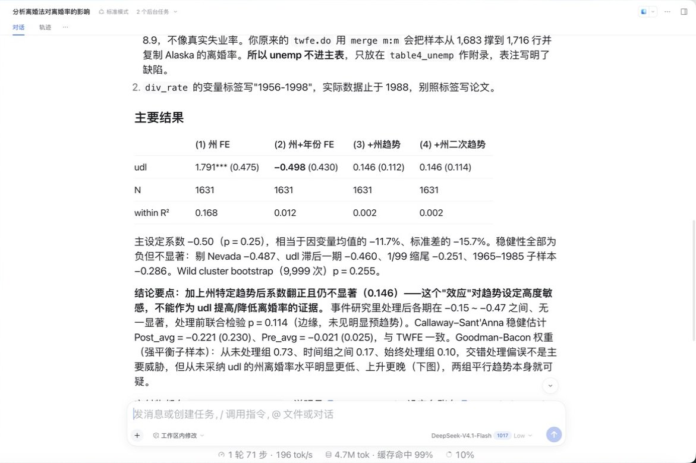
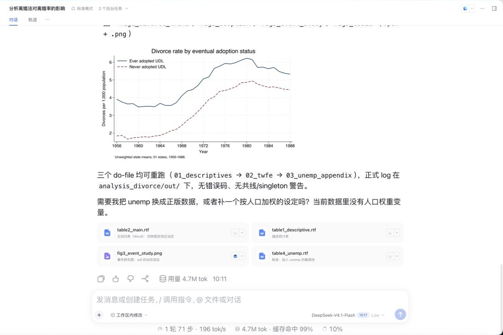

# 使用指南：在 DeepSeek Harness 里用 Stata 做一次完整的实证分析

本指南用 DeepSeek Harness 桌面版演示从安装插件到拿到回归表和图的完整过程。示例是 Wolfers (2006) 的美国各州离婚率面板：用 TWFE 估计单方离婚法（`udl`）对离婚率（`div_rate`）的影响。

所有截图都来自同一台 macOS 机器上的真实操作：DeepSeek Harness 0.2.1-rc.4、StataNow 19.5、模型 DeepSeek-V4.1-Flash。

## 准备

- DeepSeek Harness 0.2.1-rc.1 或更新版本，已登录。
- 本机已安装 Stata 16 或更新版本。插件会自动查找 Stata；如果找不到，设置环境变量 `STATA_BIN`，例如 `/Applications/StataNow/StataMP.app/Contents/MacOS/stata-mp`。
- 回归和出表会用到 `reghdfe`、`ftools`、`estout`、`coefplot` 等 SSC 包。缺哪个，agent 会先告诉你再 `ssc install`，需要联网。
- 一个工作区文件夹，里面放好数据。示例数据可以从同仓库 `whichdidshouldiuse` 插件里拿：`whichdidshouldiuse/skills/which-did-should-i-use/data/wolfers2006_didtextbook.dta`，复制到工作区并改名为 `divorce_panel.dta`。

## 一、安装插件

### 1. 打开「插件」页面，点击右上角「添加插件」



### 2. 填写安装地址

对话框接受 npm 包名、GitHub 仓库地址或本地目录路径。本插件位于仓库的 `statadataanalysis/` 子目录，地址里要写上提交号和子目录：

```text
github:wenddymacro/dsh_skills_metrics#<提交号>&path:/statadataanalysis
```

`<提交号>` 换成你要安装的版本对应的提交。



### 3. 点击「安装」，完成后点击「立即启用」

回到插件列表，「已安装插件」里能看到「Stata 实证分析」，开关处于打开状态：



点进去是插件详情页，下面会显示插件的 README：



> 如果你把已安装的插件换成另一个来源或版本，请退出并重新打开 DeepSeek Harness，新代码才会生效。

## 二、提问

### 4. 在工作区里新建会话并提问

用自然语言说清楚数据、变量和想要的结果，不需要点名 skill：

```text
分析一下当前目录下的 divorce_panel.dta：这是美国州-年面板，用 TWFE 估计单方离婚法（udl）对离婚率（div_rate）的影响，州和年份固定效应，按州聚类，出描述统计和回归表。
```

也可以在输入框里输入 `/stata-data-analysis`，直接调用这个 skill。



### 5. agent 加载 skill，用随附脚本运行 Stata

展开「已完成，用时 …」，再展开第一组步骤，可以看到 agent 先**加载技能 `stata-data-analysis`**，然后读取 skill 自带的 `run_stata.sh`、查本机 Stata 版本：



之后每个 do-file 都通过 `run_stata.sh` 以 batch 模式运行。脚本会打印 log 路径、第一个 `r(###)` 错误码和它前面的几行、共线 / singleton / 不收敛等警告，所以 agent 不会把报错的运行当成成功。批处理 log 放在 do-file 旁边，不会堆在项目根目录。

这次实测中有一个 do-file 第一次运行时什么也没算：注释里写了 `diagnostics/*`，其中的 `/*` 在 Stata 里开启了块注释，把后面的代码全部吞掉，而且不报错。agent 读 log 时发现输出不对，查出原因后改掉重跑。skill 的约定里已经写明：注释里不要出现 `/*`、`*/`。

## 三、读懂结果

### 6. Pre-Flight 报告

写回归之前，agent 先用 Stata 实际读一遍数据（`describe`、`codebook`、`misstable`、`isid`），报告变量、观测数、面板是否平衡、缺失、处理时点结构、已安装的外部命令，并复述任务。

这次它还查出了两个数据问题：工作区里另一个文件 `controls.dta` 的州-年键不唯一（Alaska 每年重复一次），所以没有把其中的 `unemp` 放进主表；`div_rate` 的变量标签写的年份范围和实际数据不符。



### 7. 主要结果与稳健性

主回归从最简单的设定开始逐步加固定效应和趋势项。回答里给出系数、标准误、N、within R²，换算成相对于因变量均值和标准差的效应大小，并列出稳健性检验（剔除个别州、滞后一期、缩尾、子样本、wild cluster bootstrap）。

因为处理是交错采纳的，agent 按 skill 的要求补做了事件研究、Goodman-Bacon 分解和 Callaway–Sant'Anna 稳健估计量，并据此判断结论有多可靠：



### 8. 生成的文件

回答末尾列出交付的表和图，可以直接点开：



工作区里的文件结构如下：

```text
analysis_divorce/
├── README.md                    # agent 写的说明：每个 do-file 做什么、怎么重跑
├── do/                          # 编号 do-file：00_* 是 Pre-Flight 检查，01_descriptives → 02_twfe → 03_unemp_appendix 是正式流程
└── out/
    ├── *.log                    # do-file 内部 log using 写的正式日志
    ├── table1_descriptive.{tex,rtf}
    ├── table2_main.{tex,rtf}    # 主回归表：.tex 给 LaTeX（booktabs），.rtf 给 Word
    ├── table3_robust.{tex,rtf}
    ├── table4_unemp.{tex,rtf}
    ├── fig*.{pdf,png}           # 图：.pdf 给 Beamer / 论文，.png 预览
    ├── analysis_sample.dta      # 分析样本
    └── twfe_estimates.ster      # 保存的估计结果，出表时不用重跑
quality_reports/
└── spec-ledger.md               # 设定台账：每个跑过的设定一行，保留和放弃的都记
```

> 回答里的每个数字都应该能在 `out/` 下的 log 里找到。skill 要求 agent 只报告 log 里真实出现的数字；拿去写论文之前，最好自己打开 log 和表核对一遍。

## 卸载

在插件详情页点击「卸载」，然后确认。

## 常见问题

| 现象 | 原因与处理 |
|---|---|
| `run_stata: Stata not found` | 设置 `STATA_BIN` 环境变量，指向 Stata 的命令行程序 |
| `Stata batch mode cannot take a do-file path with spaces` | Stata 的 batch 模式不接受带空格的 do-file 路径，换一个不含空格的文件夹或文件名 |
| do-file 跑完没有报错，但后半部分没有输出 | 多半是注释里出现了 `/*`，把后面的代码当成了块注释 |
| 缺少 `reghdfe` 等命令 | agent 会提示后 `ssc install`；离线环境请先在 Stata 里手动安装 |
| 结果不对、换了数据后数字变了 | 用同仓库的 [`statadiagnose`](../../statadiagnose/) 插件排查 |
| 重装插件后行为仍是旧版本 | 退出并重新打开 DeepSeek Harness |
