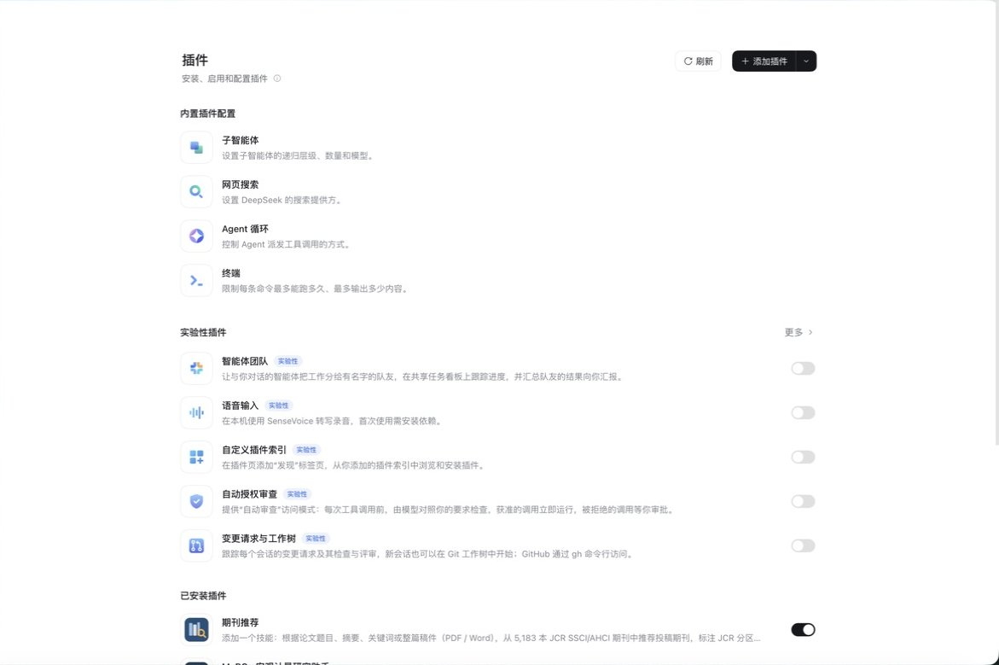
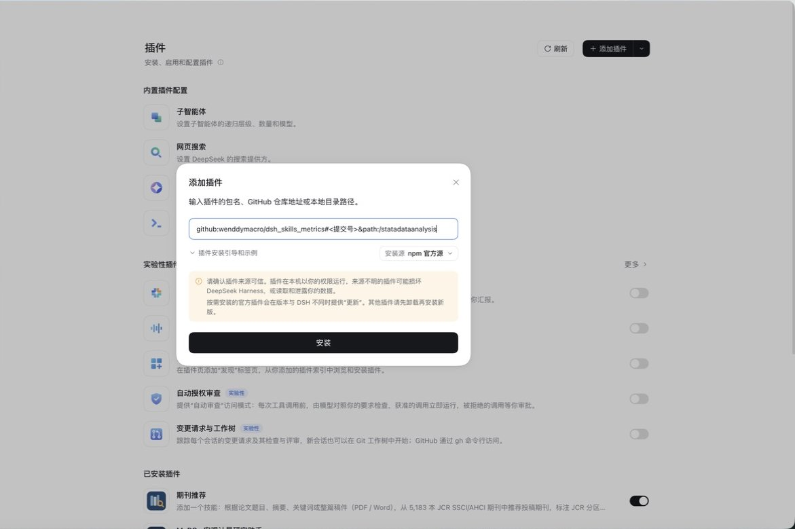
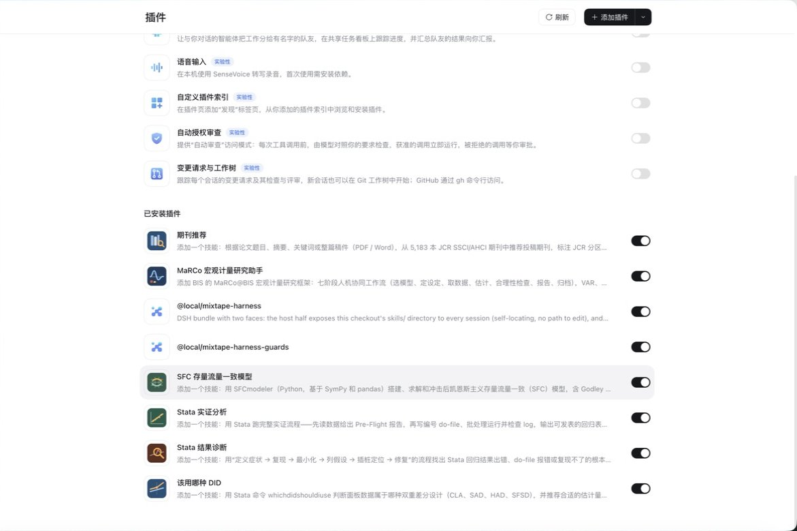
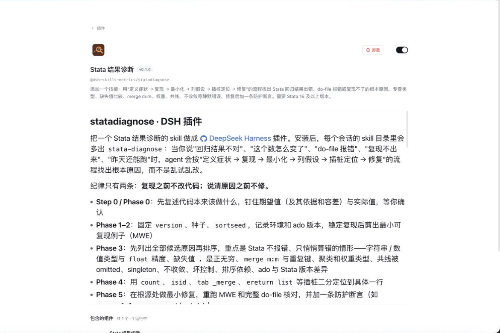
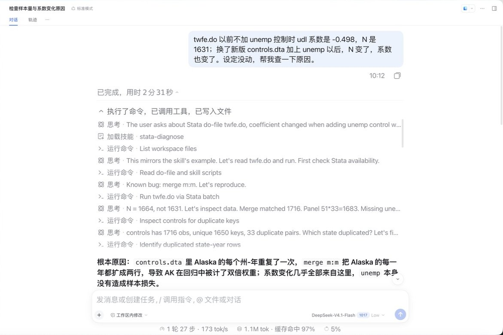
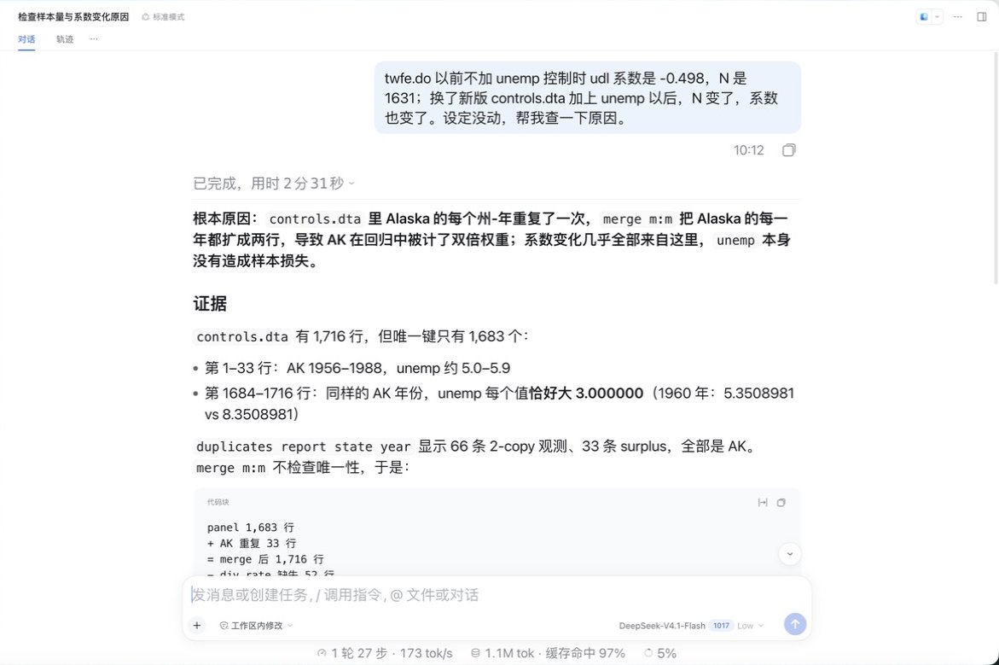
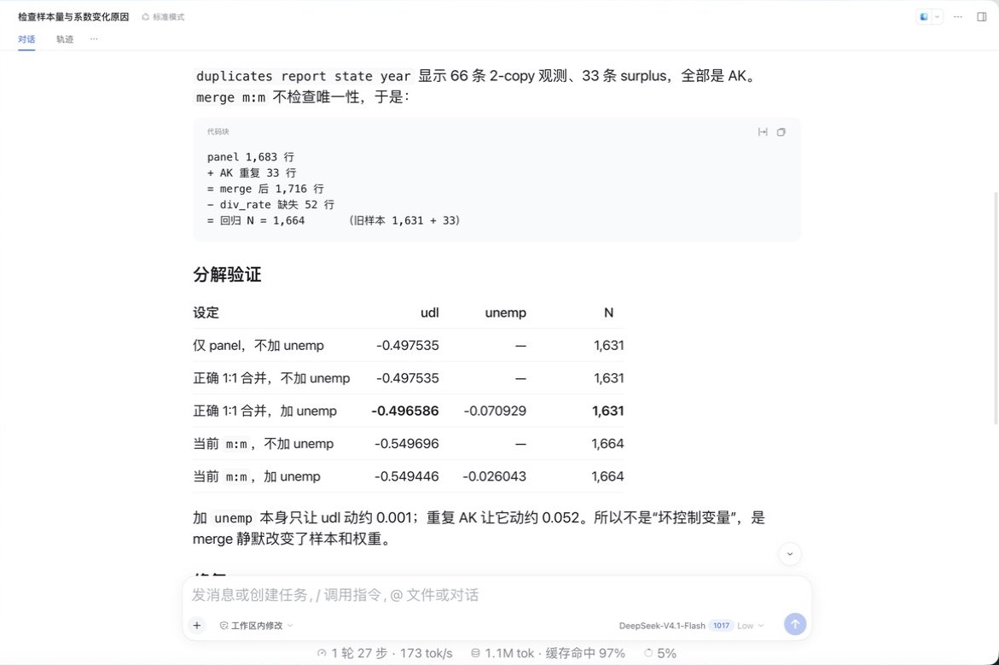
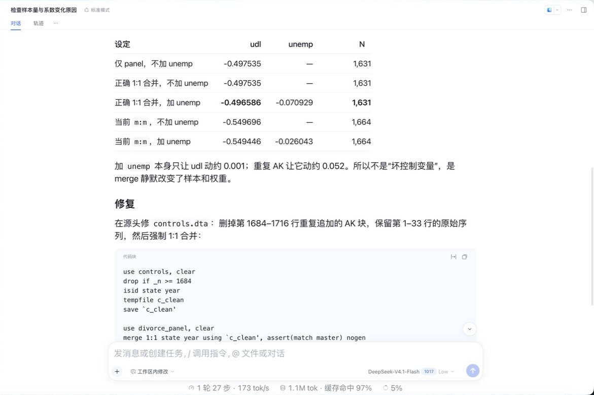
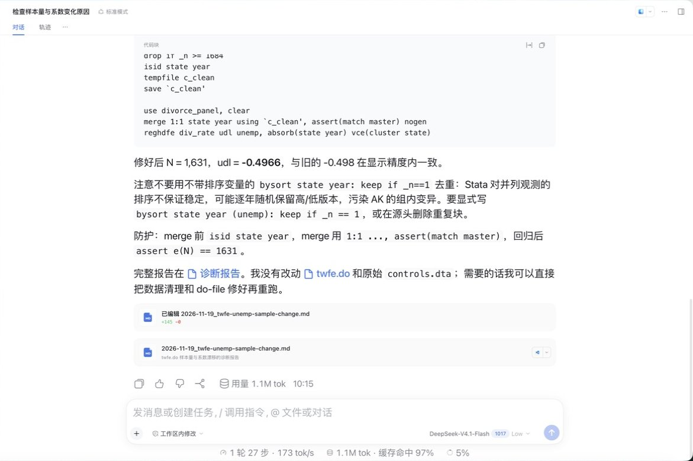

# 使用指南：在 DeepSeek Harness 里诊断"Stata 结果为什么变了"

本指南用 DeepSeek Harness 桌面版演示从安装插件到找出根本原因的完整过程。示例是一个常见的静默错误：换了新版控制变量文件后，回归的样本量和系数都变了，Stata 却没有任何报错。

所有截图都来自同一台 macOS 机器上的真实操作：DeepSeek Harness 0.2.1-rc.4、StataNow 19.5、模型 DeepSeek-V4.1-Flash。

## 准备

- DeepSeek Harness 0.2.1-rc.1 或更新版本，已登录。
- 本机已安装 Stata 16 或更新版本。插件会自动查找 Stata；如果找不到，设置环境变量 `STATA_BIN`，例如 `/Applications/StataNow/StataMP.app/Contents/MacOS/stata-mp`。
- 示例用到 `reghdfe`（`ssc install reghdfe`、`ssc install ftools`）。

### 示例数据

想照着复现，可以这样准备一个工作区：

1. 把同仓库 `whichdidshouldiuse` 插件里的 `whichdidshouldiuse/skills/which-did-should-i-use/data/wolfers2006_didtextbook.dta` 复制到工作区，改名为 `divorce_panel.dta`。
2. 把 [`examples/make_controls.do`](examples/make_controls.do) 和 [`examples/twfe.do`](examples/twfe.do) 复制到工作区，在 Stata 里运行一次 `make_controls.do`，生成 `controls.dta`。

`make_controls.do` 故意埋了一个错误：Alaska 的每个州-年在 `controls.dta` 里出现两次，第二份的 `unemp` 加了 3。`twfe.do` 用 `merge m:m` 合并，Stata 不会报错。

## 一、安装插件

### 1. 打开「插件」页面，点击右上角「添加插件」



### 2. 填写安装地址

对话框接受 npm 包名、GitHub 仓库地址或本地目录路径。本插件位于仓库的 `statadiagnose/` 子目录，地址是：

```text
github:wenddymacro/dsh_skills_metrics#fea1e496d187b5dc34d9e4b41789f0616ee583fa&path:/statadiagnose
```

这里用的是 `fea1e49`，也就是本插件合并进 `main` 时的提交。要装别的版本，把 `#` 后面换成对应的提交号即可。下图是截图时（插件尚未合并）填的同仓库另一个插件 `statadataanalysis` 的地址，提交号处是占位符；格式相同，实际填写时用上面的地址：



### 3. 点击「安装」，完成后点击「立即启用」

回到插件列表，「已安装插件」里能看到「Stata 结果诊断」，开关处于打开状态：



点进去是插件详情页，下面会显示插件的 README：



> 如果你把已安装的插件换成另一个来源或版本，请退出并重新打开 DeepSeek Harness，新代码才会生效。

## 二、描述症状

### 4. 新建会话，说清楚"期望 vs. 实际"

诊断的第一步是钉住症状：原来是多少、现在是多少、改了什么。说得越具体，agent 越快：

```text
twfe.do 以前不加 unemp 控制时 udl 系数是 -0.498，N 是 1631；换了新版 controls.dta 加上 unemp 以后，N 变了，系数也变了。设定没动，帮我查一下原因。
```

也可以在输入框里输入 `/stata-diagnose`，直接调用这个 skill。只想要诊断、不想让它改文件，就加一句"只诊断不改"，或者带上 `--no-fix`。

### 5. agent 加载 skill，复现并插桩定位

展开「已完成，用时 …」可以看到步骤：agent 先**加载技能 `stata-diagnose`**，用 skill 自带的 `run_stata.sh` 复现问题（N = 1664，不是 1631），然后逐步检查 `controls.dta` 的键是否唯一、重复的是哪个州：



这一步对应 skill 的 Phase 1–4：先稳定复现，再用 `count`、`duplicates report`、`isid`、`list` 这类命令二分定位，而不是猜一个原因就去改代码。

## 三、读懂结果

### 6. 根本原因

回答第一句就是根本原因，后面是证据：



### 7. 分解验证

agent 把"加了 `unemp`"和"merge 出了重复行"两个因素拆开，各跑一遍回归。表里能看出：加 `unemp` 本身只让系数变了约 0.001，系数的变化几乎全部来自 Alaska 被重复计入。所以问题不是"坏控制变量"，而是 merge 悄悄改变了样本和权重。



### 8. 修复方案

修复在根源处做：删掉重复追加的 Alaska 记录，改用 `merge 1:1 ..., assert(match master)`。修好后 N 回到 1,631，系数与原来的 −0.498 在显示精度内一致：



### 9. 防护断言与诊断报告

回答最后给出一条防护：merge 前 `isid state year`，merge 用 `1:1` 加 `assert()`，回归后 `assert e(N) == 1631`。它还提醒了一个容易踩的坑：不带排序变量的 `bysort state year: keep if _n==1` 去重，保留下来的是哪一份并不确定。

完整的诊断报告写在 `quality_reports/diagnoses/YYYY-MM-DD_<slug>.md`，包括症状、最小可复现例子、根本原因、修复、验证和防护：



> 这次 agent 没有直接改 `controls.dta` 和 `twfe.do`，而是把修复方案写进报告，问你要不要动手。原始数据文件被改动后很难追溯，先确认再改更稳妥。回复"按方案修好并重跑"即可让它动手。

## 它专门查哪些错误

下面这些情况在 Stata 里**都不报错**，只会悄悄算错。skill 在列候选原因时会逐一考虑：

| 类别 | 例子 |
|---|---|
| 类型 | 数值被读成字符串；`gen` 默认 `float`，大 ID 和金额丢精度 |
| 缺失值 | `.` 是正无穷，`gen high = (x > 100)` 会把缺失记成 1 |
| merge | `merge m:m` 按顺序配对而不是笛卡尔积；本该唯一的键有重复 |
| 设定 | 聚类层级不对；固定效应重复吸收；`L.`/`F.` 遇到不连续的时间产生缺失 |
| 坏控制 | 控制了处理之后才发生的变量 |
| 数值 | 关键变量因共线被 omitted；singleton 被删；不收敛；完全分离 |
| 权重 | `fw`/`pw`/`aw` 用混；权重为 0 或缺失被悄悄删掉 |
| 注释吞代码 | 注释里的 `/*` 开启块注释，后面的命令全被跳过 |
| 环境 | `reghdfe` 新旧版本默认值不同；没写 `version`；`sort` 遇到并列值时顺序不固定 |

## 卸载

在插件详情页点击「卸载」，然后确认。

## 常见问题

| 现象 | 原因与处理 |
|---|---|
| `run_stata: Stata not found` | 设置 `STATA_BIN` 环境变量，指向 Stata 的命令行程序 |
| `Stata batch mode cannot take a do-file path with spaces` | Stata 的 batch 模式不接受带空格的 do-file 路径，换一个不含空格的文件夹或文件名 |
| agent 一直在问期望值 | 这是 skill 的设计：说不出"期望是多少、依据是什么"，就无法判断哪里错了。补充上次的 log、论文表格或手算结果即可 |
| 想从头做一个分析 | 用同仓库的 [`statadataanalysis`](../../statadataanalysis/) 插件 |
| 重装插件后行为仍是旧版本 | 退出并重新打开 DeepSeek Harness |
