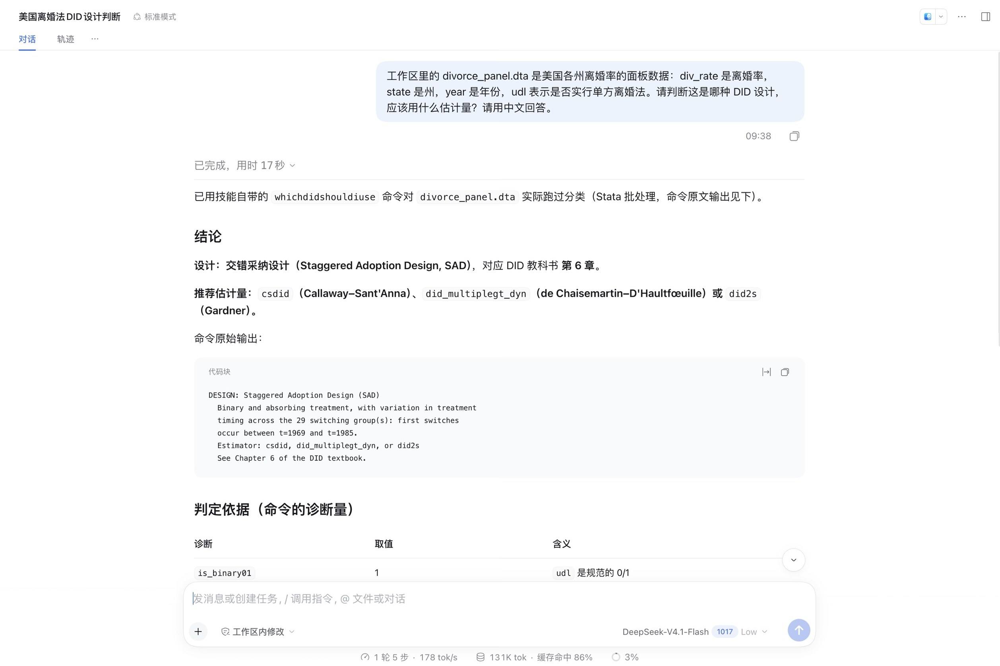

# whichdidshouldiuse · DSH 插件

把 [whichDIDshouldIuse](https://github.com/Credible-Answers/whichDIDshouldIuse)（Trelles、de Chaisemartin、Quispe 的 Stata 命令）做成
[DeepSeek Harness](https://github.com/deepseek-ai/deepseek-harness) 插件。安装后，每个会话的 skill 目录里会多出
`which-did-should-i-use`：当你问"我的面板该用哪种 DID / 哪个估计量"时，agent 会在本机用 Stata 运行 `whichdidshouldiuse`，
报告设计类型（CLA、SAD、HAD、SFSD 或 OTHER）、推荐估计量、对应的教科书章节，以及所有可能影响结论的样本调整。

它只**分类**，不**估计**。

**图文使用指南：[docs/GUIDE.md](docs/GUIDE.md)**（从安装到读懂结果，附 DeepSeek Harness 桌面版实测截图）



## 依赖

- DeepSeek Harness ≥ 0.2.1-rc.1
- 本机 Stata 16 及以上版本（会自动查找；找不到时设置 `STATA_BIN`，例如
  `/Applications/StataNow/StataMP.app/Contents/MacOS/stata-mp`）
- 首次运行时，命令会从 SSC 安装 `distinct`；没有 stayers 的 HAD 面板还会用到 `did_had`、`nprobust`、`gtools`。
  如果本机的 `did_had` 太旧（不支持 `_no_updates`），HAD 的子情形会报告为 `undetermined`，在 Stata 里运行
  `ssc install did_had, replace` 升级即可。

## 安装

**推荐：从 npm 安装。** 打开「插件 → 添加插件」，填入包名，点击「安装」，再点击「立即启用」。
这样装的插件，dsh 的「插件」页能直接检查和更新版本。每一步的截图见 [使用指南](docs/GUIDE.md)。

```text
@dsh-skills-metrics/whichdidshouldiuse
```

命令行（CLI 管理的 profile）：

```bash
dsh plugin --profile <profile> add @dsh-skills-metrics/whichdidshouldiuse
```

**也可以从 GitHub 安装**（npm 不通时用）。`#` 后面是版本标签，下面是目前最新的版本 0.2.0：

```text
github:wenddymacro/dsh_skills_metrics#whichdidshouldiuse-v0.2.0&path:/whichdidshouldiuse
```

```bash
dsh plugin --profile <profile> add "github:wenddymacro/dsh_skills_metrics#whichdidshouldiuse-v0.2.0&path:/whichdidshouldiuse"
```

从本地 checkout 安装（便于开发）：

```bash
dsh plugin --profile <profile> add "link:/abs/path/to/dsh_skills_metrics/whichdidshouldiuse"
```

如果把已安装的插件换成另一个来源或版本，需要重启 DeepSeek Harness，新代码才会生效。

## 更新

插件会在 DeepSeek Harness 启动时，在后台查看本仓库有没有更新的发布标签（每 12 小时最多查一次，
查不到或网络不通时不影响使用）。有新版本时，下次使用插件的会话里，agent 会用一句话提醒你，问要不要更新：

- **从 npm 安装的**：agent 会请你到「插件」页点本插件的更新按钮。不用等提醒，随时也可以在那里检查更新。
  新版本刚发布时，npm 镜像可能要过几分钟才同步。
- **从 GitHub 安装的**：你同意后，agent 通过 dsh 的 `plugin_manager` 工具装新版本的标签地址，dsh 会再请你批准一次。
  也可以自己把上面地址里的版本号换成新的标签（见 [Tags](https://github.com/wenddymacro/dsh_skills_metrics/tags)），重新「添加插件」。

不会在你不知情的情况下更新。查询结果保存在 `~/.dsh/cache/dsh-skills-metrics/whichdidshouldiuse.json`；不想联网检查，就设置环境变量
`DSH_SKILLS_METRICS_UPDATE_CHECK=0`。

**从旧版本换过来**：0.2.0 之前的版本只能从 GitHub 提交号安装，没有更新提醒。在「插件」页卸载旧版，
再按上面的方法从 npm 安装一次，以后就能直接在「插件」页更新。

## 使用

直接用自然语言提问即可，例如：

> 当前目录下的 panel.dta 里，y 是结果变量，id 是个体，year 是年份，d 是处理变量。这是哪种 DID 设计？该用什么估计量？

也可以输入 `/which-did-should-i-use` 显式调用这个 skill。skill 自带 4 个教科书示例面板（`skills/which-did-should-i-use/data/`），
可以用来演示或检查环境是否就绪。

## 结构

```
whichdidshouldiuse/
├── package.json            # dsh.bundle 声明，不打包任何依赖
├── cordis.patch.yml        # 挂载本包的插件
├── index.js                # 用 dsh 自带的 skill-filesystem provider 挂载 skills/
├── update-check.js         # 后台检查新版本，写出更新状态文件
├── locale/{en,zh}.json     # 插件管理器中显示的标题与描述
├── icon.svg
├── skills/which-did-should-i-use/
│   ├── SKILL.md            # agent 的工作流程与结果解读
│   ├── scripts/run_whichdid.sh   # 以 batch 模式运行 Stata，只输出报告和 return list
│   ├── stata/              # 上游 .ado / .sthlp / LICENSE（MIT）
│   └── data/               # 4 个教科书示例面板
└── test.mjs                # node --test test.mjs
```

## 测试

```bash
node --test test.mjs
```

单元测试检查 manifest、patch、locale、SKILL frontmatter 和 `apply()` 的挂载方式；本机有 Stata 时，集成测试会用 4 个示例面板
复现上游 README 中的分类结果（CLA、SAD、SFSD、HAD）。

## 许可与致谢

插件代码采用 MIT 许可。`skills/which-did-should-i-use/stata/` 与 `data/` 来自上游
[Credible-Answers/whichDIDshouldIuse](https://github.com/Credible-Answers/whichDIDshouldIuse)（提交 `d032764`，MIT 许可，版权归原作者所有）。
设计定义与估计量建议来自 de Chaisemartin & D'Haultfœuille (2026), *Causal Inference with Differences-in-Differences:
Credible Answers to Hard Questions*, Princeton University Press。
