# 使用指南：在 DeepSeek Harness 里判断「该用哪种 DID」

本指南用 DeepSeek Harness 桌面版演示从安装插件到得出结论的完整过程。示例数据是插件自带的 Wolfers (2006) 美国各州离婚率面板，预期结果是 **SAD（交错采纳设计）**。

所有截图都来自同一台 macOS 机器上的真实操作：DeepSeek Harness 0.2.1-rc.4、StataNow 19.5、模型 DeepSeek-V4.1-Flash。

## 准备

- DeepSeek Harness 0.2.1-rc.1 或更新版本，已登录。
- 本机已安装 Stata 16 或更新版本。插件会自动查找 Stata；如果找不到，设置环境变量 `STATA_BIN`，例如 `/Applications/StataNow/StataMP.app/Contents/MacOS/stata-mp`。
- 第一次运行时，`whichdidshouldiuse` 会从 SSC 安装 `distinct`，需要联网。

## 一、安装插件

### 1. 打开「插件」页面，点击「添加插件」

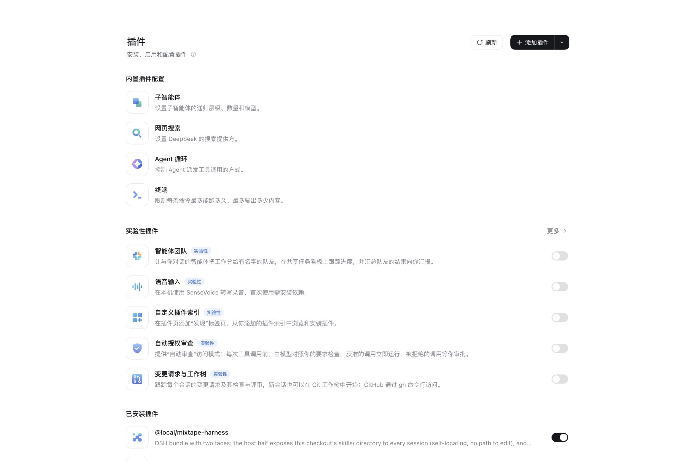

### 2. 在弹出的对话框里填写安装地址

对话框接受 npm 包名、GitHub 仓库地址或本地目录路径。

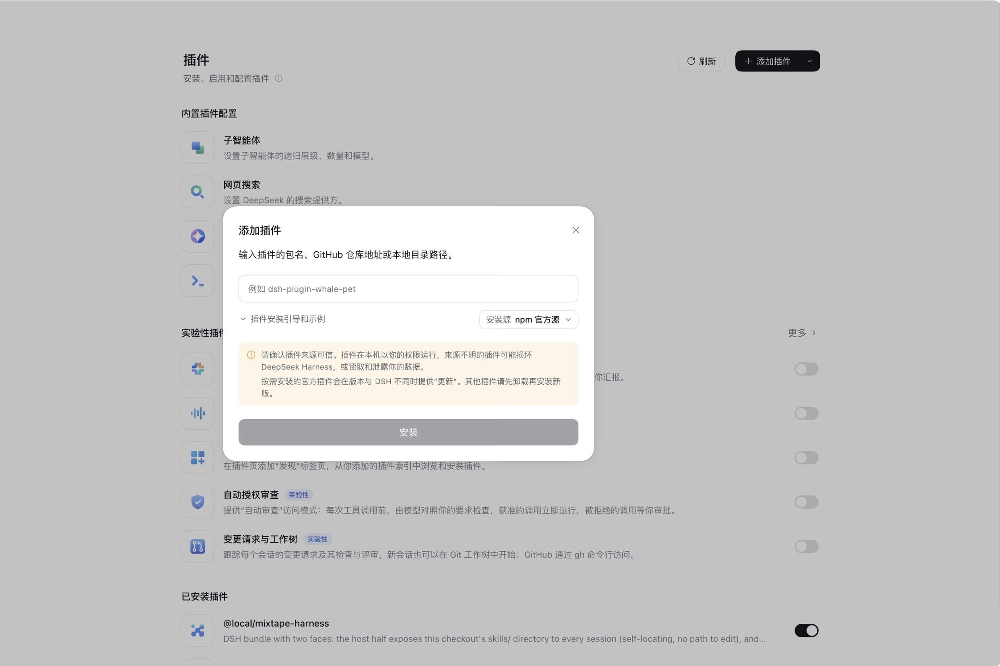

本插件位于仓库的 `whichdidshouldiuse/` 子目录，所以地址里要写上提交号和子目录：

```text
github:wenddymacro/dsh_skills_metrics#<提交号>&path:/whichdidshouldiuse
```

`<提交号>` 换成你要安装的版本对应的提交，截图里用的是 `2ef71ac20f3fdad01109efdd953b5ae5f30b19b9`。

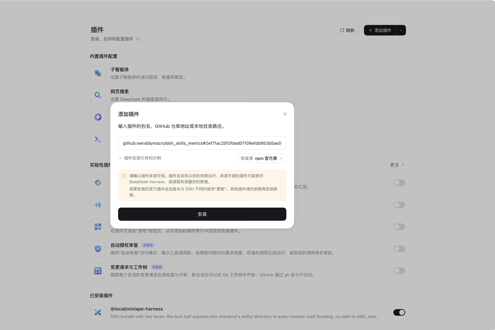

### 3. 点击「安装」，等待下载完成

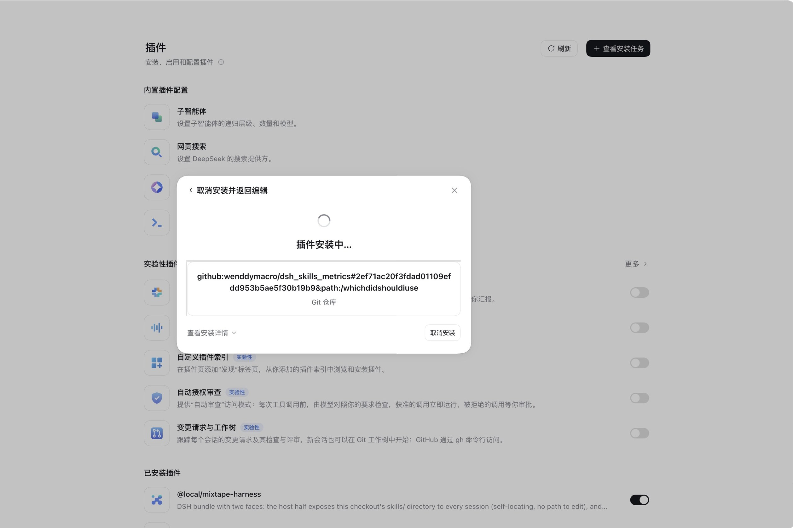

### 4. 安装完成后点击「立即启用」


启用后，插件详情页的开关处于打开状态，「包含的组件」显示「1 运行中」：

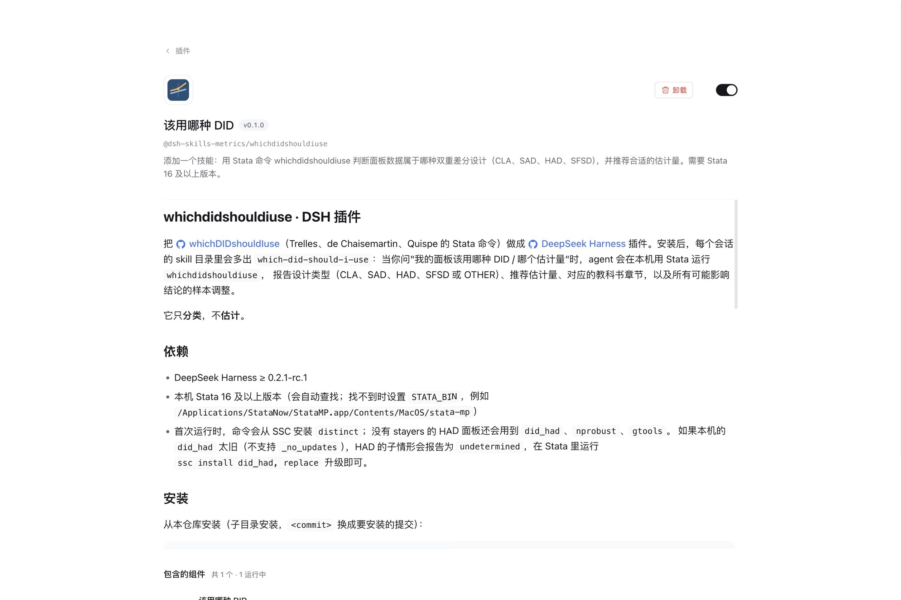

回到插件列表，「已安装插件」里能看到「该用哪种 DID」：

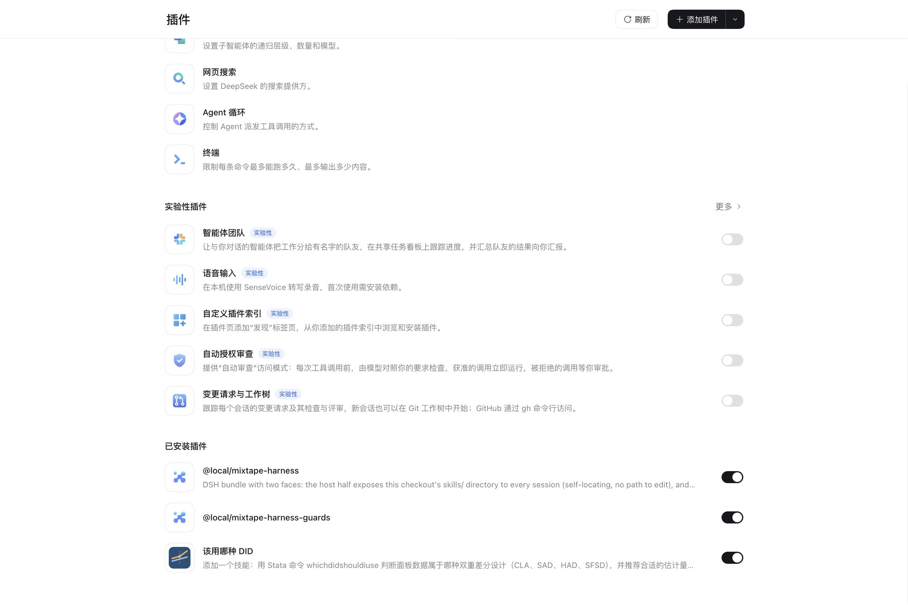

> 如果你曾经用本地目录安装过这个插件，又改成从 GitHub 安装，请先退出并重新打开 DeepSeek Harness。不重启的话，正在运行的进程会继续使用旧版本的代码。

## 二、提问

### 5. 新建会话并提问

把数据文件放进当前工作区，然后用自然语言描述变量的含义，并提出问题。截图中的数据文件在「默认工作区」里：

```text
工作区里的 divorce_panel.dta 是美国各州离婚率的面板数据：div_rate 是离婚率，state 是州，year 是年份，udl 表示是否实行单方离婚法。请判断这是哪种 DID 设计，应该用什么估计量？请用中文回答。
```


也可以在输入框里输入 `/which-did-should-i-use`，直接调用这个 skill。

### 6. agent 自动加载 skill 并运行 Stata


展开「已完成，用时 … 秒」，可以看到具体步骤：agent 先**加载技能 `which-did-should-i-use`**，再查看工作区里的文件，用 `--describe` 查看数据，最后运行分类命令。

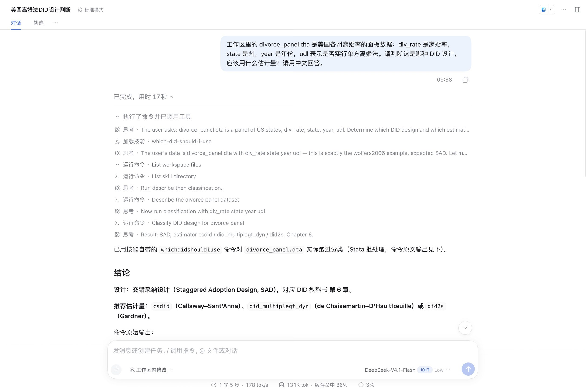

切换到「轨迹」标签页，可以查看每一次工具调用和返回结果：调用 `skill` 加载技能，再通过 `bash` 运行插件自带的 `run_whichdid.sh`，由它在 batch 模式下调用 Stata。

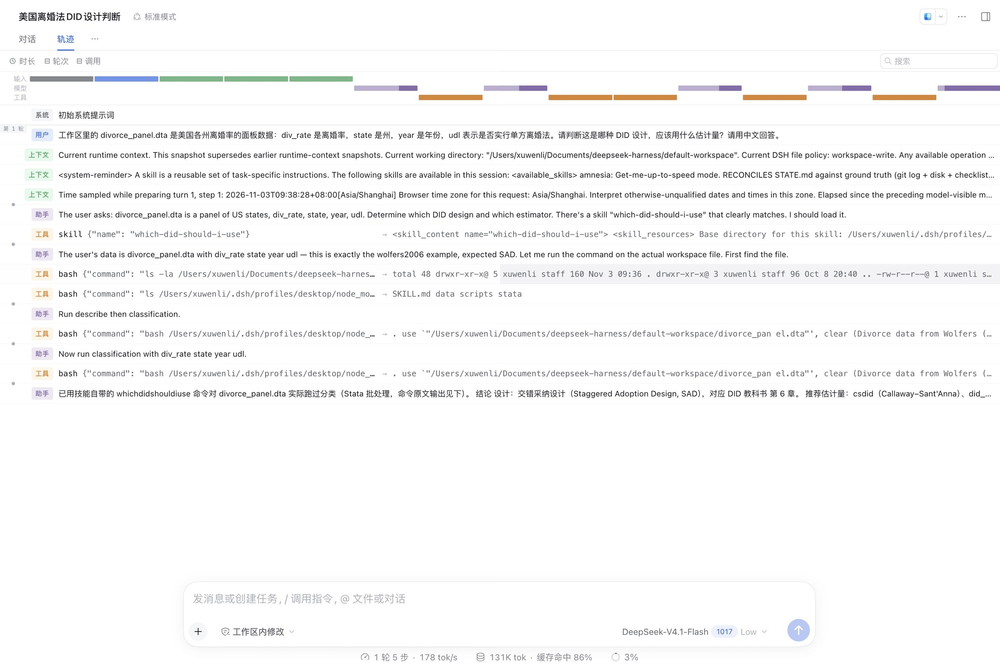

## 三、读懂结果

### 7. 结论

回答开头给出设计类型、推荐的估计量和教科书章节，并附上命令的原始输出：

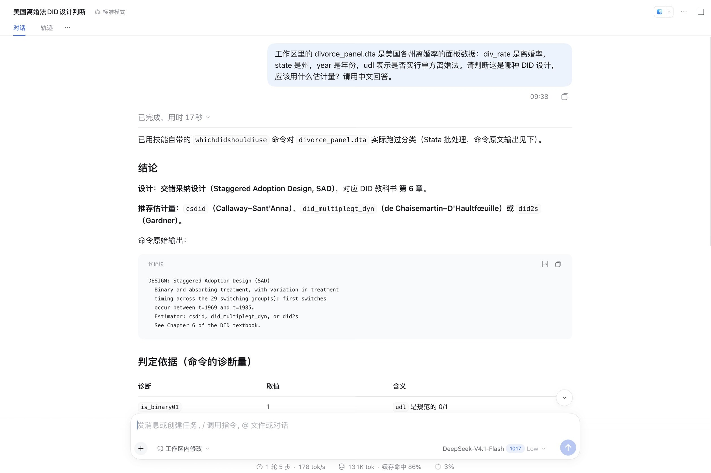

### 8. 判定依据

agent 会把命令返回的诊断量整理成表格，说明为什么是 SAD 而不是其他设计：处理变量是 0/1 且具有吸收性，各州实行法律的年份不同，同时存在从未实行的州。

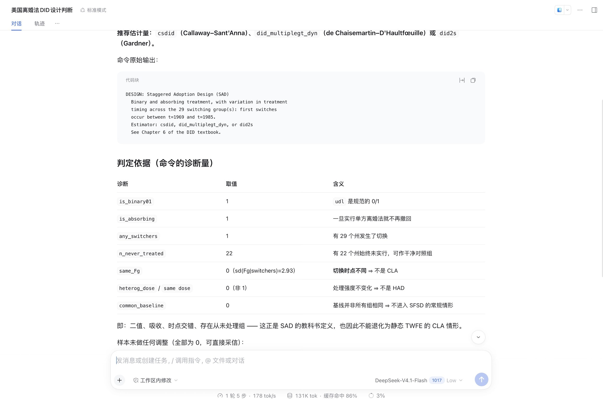

### 9. 样本调整与落地建议

回答会检查命令是否对样本做过调整。最重要的是 `n_demoted`（被降级为对照组的组数）和被剔除的组数。如果它们不为 0，agent 会用 `strict` 选项再跑一次，比较两种结果是否一致。最后给出估计方法的建议：

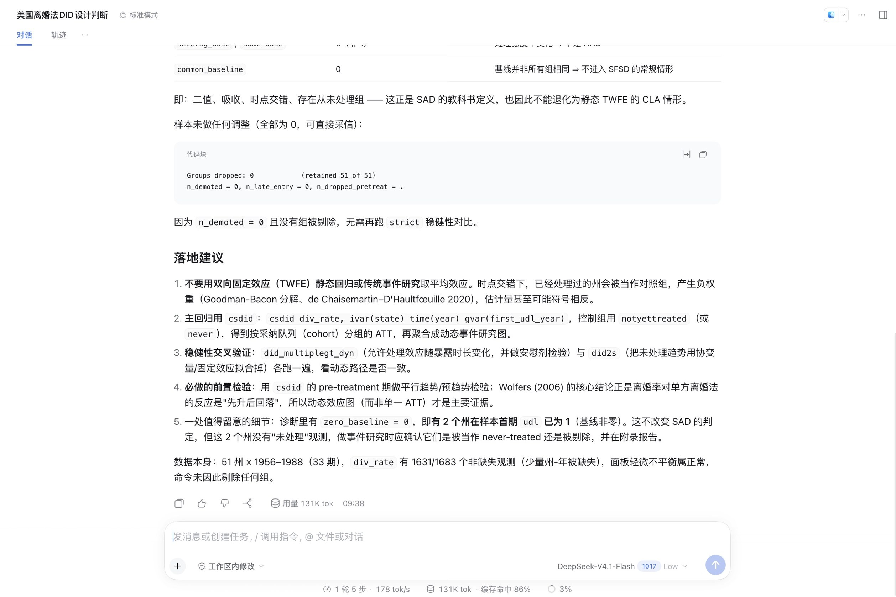

> 这个插件只做**分类**，不做**估计**。回答里的 `csdid`、`did_multiplegt_dyn` 等命令是下一步估计的建议，实际估计需要另外运行。

## 卸载

在插件详情页点击「卸载」，然后确认：

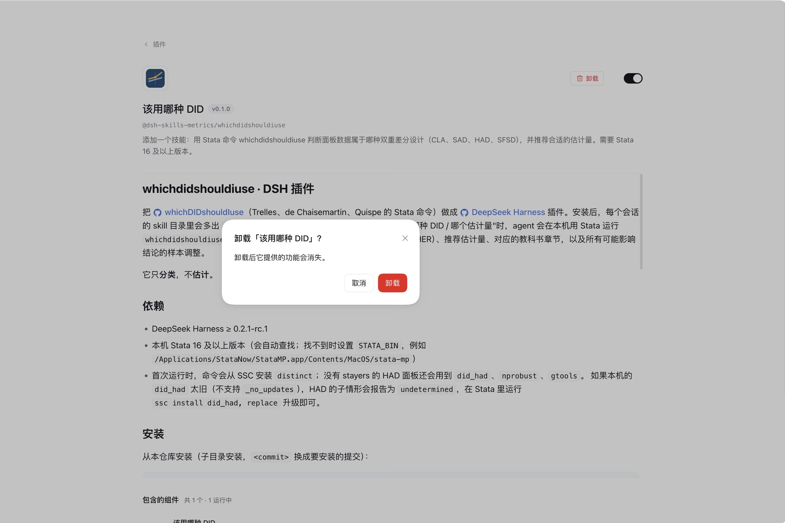

## 常见问题

| 现象 | 原因与处理 |
|---|---|
| `run_whichdid: Stata not found` | 设置 `STATA_BIN` 环境变量，指向 Stata 的命令行程序 |
| HAD 子情形显示 `undetermined`，`r(had_why)` 里有 `rc = 198` | 本机的 `did_had` 版本过旧，在 Stata 里运行 `ssc install did_had, replace` 升级 |
| 回答用的是英文 | 在提问时加上「请用中文回答」 |
| 重装插件后，路径或行为仍是旧版本 | 退出并重新打开 DeepSeek Harness |
